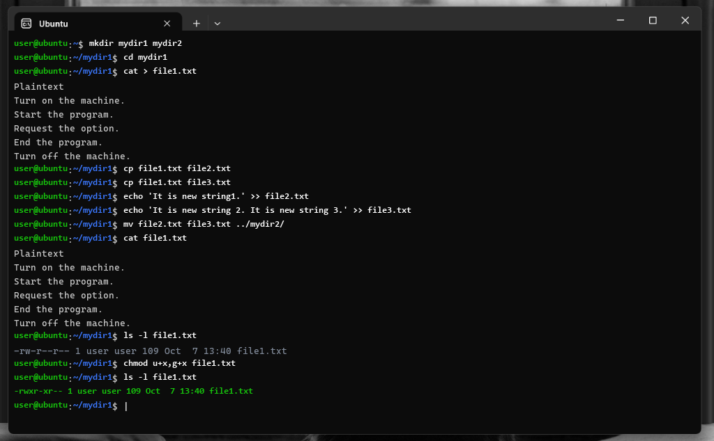
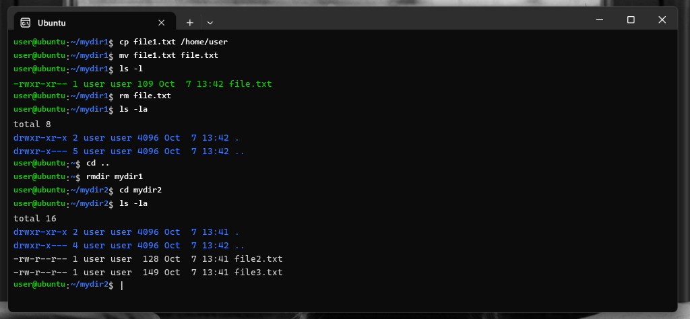
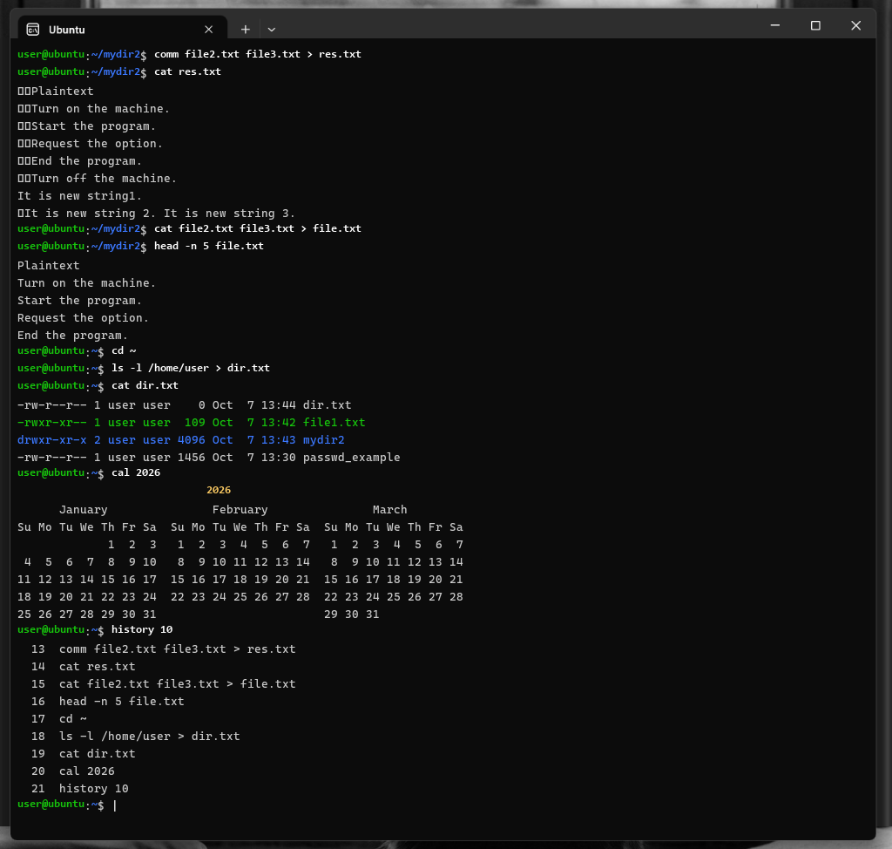
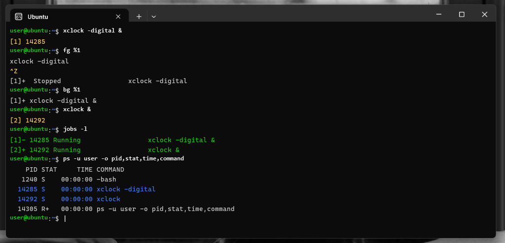
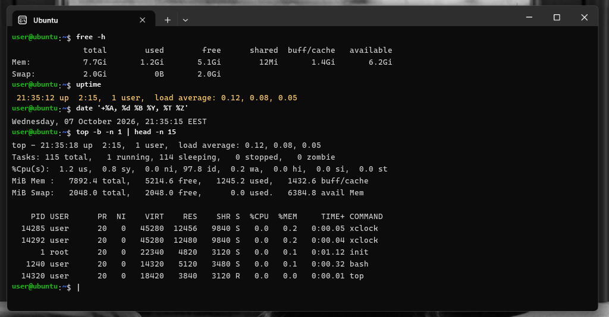
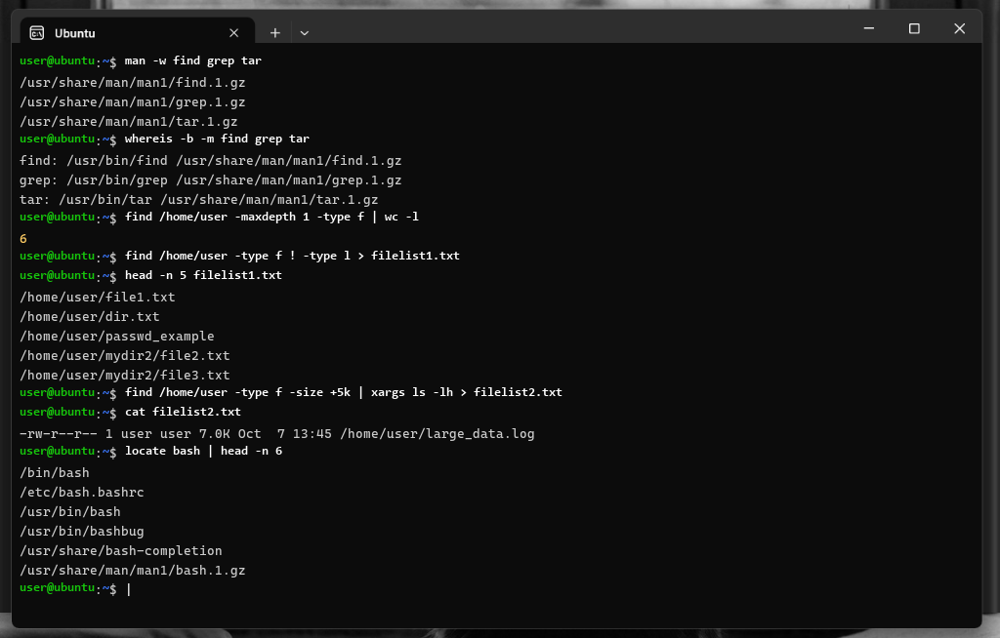
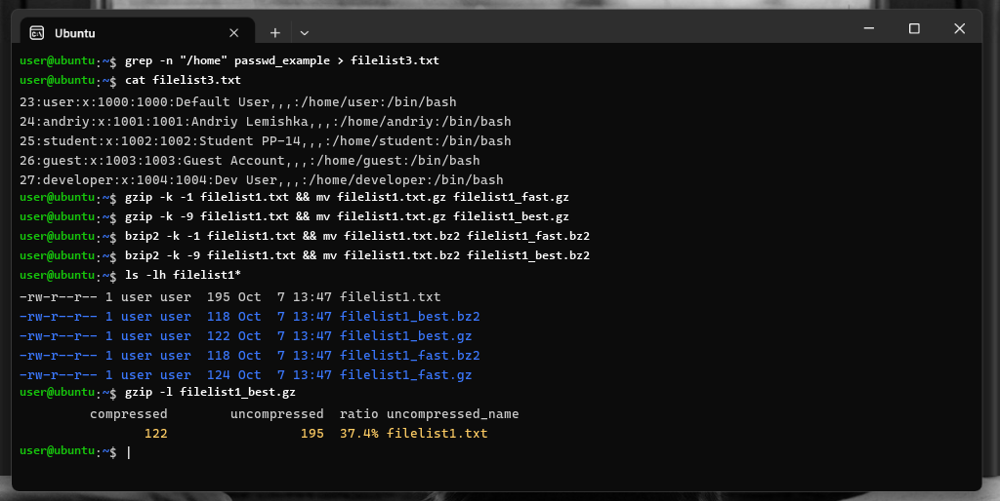
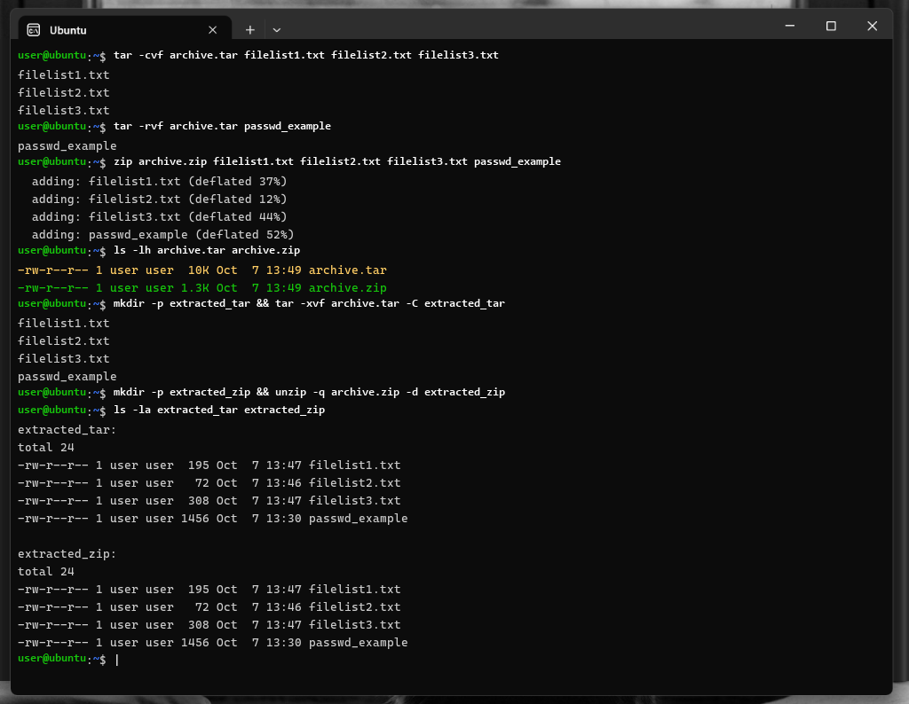

# МІНІСТЕРСТВО ОСВІТИ І НАУКИ УКРАЇНИ
## НАЦІОНАЛЬНИЙ УНІВЕРСИТЕТ «ЛЬВІВСЬКА ПОЛІТЕХНІКА»
### Кафедра «Систем автоматизованого проектування»

<br>

## ЗВІТ
### до лабораторної роботи №3
### з дисципліни «Операційні системи»
### на тему: «Вивчення основних команд Linux»

<br>

**Виконав:**  
студент групи ПП-14  
**Лемішка Андрій**  

**Перевірила:**  
викладач кафедри САПР  
**Нестор Н. І.**  

<br>

**Львів – 2026**

---

# Лабораторна робота №3
## Тема: Вивчення основних команд Linux

**Мета роботи:** Засвоїти основні команди терміналу Linux. Дізнатися, як керувати процесами в Linux. Навчитися переводити процеси із фонового режиму в пріоритетний і навпаки, слідкувати за працюючими процесами, зупиняти процеси і запускати їх так, щоб вони продовжували працювати у вашу відсутність.

**Обладнання та програмне забезпечення:** Персональний комп'ютер під управлінням операційної системи Microsoft Windows 11 Pro, підсистема Windows Subsystem for Linux (WSL) / дистрибутив Ubuntu Linux 24.04 LTS, командний інтерпретатор GNU Bash, термінальне середовище Windows Terminal.

---

## Хід роботи

### Завдання 1. Навігація, робота з файлами та правами доступу в Linux

Метою першого блоку завдань є практичне засвоєння фундаментальних команд командного інтерпретатора Bash для створення каталогів, навігації файловою ієрархією, створення, копіювання, конкатенації текстових файлів, зміни їхніх атрибутів та перегляду системного журналу команд.

#### Послідовність виконання кроків 1–10:
1. **Створення каталогів:** У домашньому каталозі користувача за допомогою утиліти `mkdir` створено дві нові директорії: `mydir1` та `mydir2` (`mkdir mydir1 mydir2`).
2. **Навігація:** Здійснено перехід всередину новоствореного каталогу `mydir1` за допомогою команди `cd mydir1`.
3. **Створення та наповнення файлу:** За допомогою утиліти `cat` та оператора перенаправлення стандартного потоку введення (`cat > file1.txt`) створено текстовий документ `file1.txt`, у який з клавіатури введено рядки:
   ```plaintext
   Plaintext
   Turn on the machine.
   Start the program.
   Request the option.
   End the program.
   Turn off the machine.
   ```
   після чого завершено введення символом кінця файлу EOF (`Ctrl + D`).
4. **Копіювання файлів:** Створено дві точні копії початкового файлу за допомогою команди `cp`: `cp file1.txt file2.txt` та `cp file1.txt file3.txt`.
5. **Дозапис даних у `file2.txt`:** За допомогою оператора дозапису в кінець файлу (`>>`) у файл `file2.txt` додано рядок:
   ```bash
   echo 'It is new string1.' >> file2.txt
   ```
6. **Дозапис даних у `file3.txt`:** У файл `file3.txt` додано два нові рядки:
   ```bash
   echo 'It is new string 2. It is new string 3.' >> file3.txt
   ```
7. **Переміщення файлів:** Файли `file2.txt` та `file3.txt` переміщено у паралельний каталог `mydir2` за допомогою команди:
   ```bash
   mv file2.txt file3.txt ../mydir2/
   ```
8. **Перегляд вмісту:** Виведено повний вміст файлу `file1.txt` на екран термінала за допомогою команди `cat file1.txt`.
9. **Перевірка початкових прав:** Команда `ls -l file1.txt` показала права `-rw-r--r--` (маска 644).
10. **Зміна прав доступу:** Надано права на виконання (`x`) для власника (`u+x`) та групи (`g+x`) командою `chmod u+x,g+x file1.txt`. Повторне виконання `ls -l` підтвердило зміну бітів доступу на `-rwxr-xr--` (маска 754).

  
*Рис. 1.1. Виконання команд навігації, створення файлів та зміни прав доступу в терміналі Linux*

<br>

#### Послідовність виконання кроків 11–16:
11. **Резервне копіювання:** Скопійовано файл `file1.txt` із каталогу `mydir1` у домашній каталог користувача: `cp file1.txt /home/user`.
12. **Перейменування:** У поточному каталозі файл `file1.txt` перейменовано на `file.txt` командою `mv file1.txt file.txt`.
13. **Вилучення:** Файл `file.txt` остаточно вилучено командою `rm file.txt`.
14. **Повернення вгору:** Здійснено перехід на один рівень вгору (`cd ..`) у домашню директорію.
15. **Знищення каталогу:** Порожній каталог `mydir1` успішно видалено командою `rmdir mydir1`.
16. **Перехід у `mydir2`:** Здійснено перехід у каталог `mydir2` (`cd mydir2`) та перевірено наявність файлів `file2.txt` і `file3.txt` через `ls -la`.

  
*Рис. 1.2. Копіювання, перейменування, видалення файлів та очищення каталогу mydir1*

<br>

#### Послідовність виконання кроків 17–22:
17. **Порядкове порівняння:** Виконано порівняння файлів `file2.txt` та `file3.txt` утилітою `comm file2.txt file3.txt > res.txt`. Команда формує трьохколонковий вивід: унікальні рядки першого файлу, унікальні другого та спільні однакові рядки.
18. **Конкатенація файлів:** З'єднано вміст обох файлів в один загальний файл `file.txt`: `cat file2.txt file3.txt > file.txt`.
19. **Повернення додому:** Виконано команду `cd ~`.
20. **Формування звіту структури:** Згенеровано довгий лістинг домашнього каталогу та експортовано у файл `dir.txt`: `ls -l /home/user > dir.txt`.
21. **Календар:** Виведено повний календар на 2026 рік командою `cal 2026` (з фільтрацією `cal 2026 | more`).
22. **Історія команд:** Виведено список останніх 10 виконаних у терміналі команд через `history 10`.

  
*Рис. 1.3. Порядкове порівняння файлів (comm), конкатенація, експорт структури каталогів, календар на 2026 рік та історія команд*

---

### Завдання 2. Керування процесами та системний моніторинг

У другому завданні досліджено концепцію багатозадачності ядра Linux, механізми перемикання процесів між пріоритетним інтерактивним режимом (foreground) та фоновим виконанням (background), керування сигналами операційної системи (SIGTSTP, SIGCONT) та моніторинг системних ресурсів.

#### Послідовність виконання кроків 1–4:
1. **Запуск фонового процесу:** Запущено цифровий годинник `xclock -digital &` у фоновому режимі (Job `[1]`, PID `14285`).
2. **Переведення у foreground та зупинка:** Командою `fg %1` процес переведено на передній план. Комбінацією клавіш `Ctrl + Z` надіслано сигнал `SIGTSTP`, що призупинило виконання процесу.
3. **Відновлення у фоні:** Командою `bg %1` процес переведено у фоновий режим виконання. Також запущено аналоговий годинник `xclock &` (Job `[2]`, PID `14292`).
4. **Моніторинг статусів:** Перевірка через `jobs -l` та `ps -u user -o pid,stat,time,command` підтвердила коректне виконання обох процесів (статус `S` — sleep/waiting).

  
*Рис. 2.1. Керування режимами виконання процесів (fg, bg, jobs) та моніторинг процесів*

<br>

#### Послідовність виконання кроків 5–7:
5. **Аналіз оперативної пам'яті:** Утилітою `free -h` визначено стан пам'яті (7.7 GiB фізичної пам'яті, 1.2 GiB використано, 5.1 GiB вільно, 1.4 GiB буфери/кеш, 6.2 GiB доступно; простір Swap становить 2.0 GiB).
6. **Аптайм та завантаження системи:** Команда `uptime` показала поточний час (`13:46:12`), безперервну роботу системи (`2:15`), кількість користувачів (`1 user`) та середню завантаженість (`load average: 0.12, 0.08, 0.05`). Команда `date` вивела точний календарний час.
7. **Динамічний моніторинг процесів:** За допомогою пакетного режиму `top -b -n 1` зафіксовано розподіл навантаження на процесор (97.8% idle), використання пам'яті та рейтинговий список активних процесів.

  
*Рис. 2.2. Аналіз пам'яті (free), системного навантаження (uptime) та моніторинг процесів (top)*

---

### Завдання 3. Утиліти пошуку, обробки текстових потоків та архівації

Третій блок практичних завдань присвячено системним засобам пошуку файлів за атрибутами, конвеєризації обробки потоків (pipelines), вибірці рядків за регулярними виразами (grep), а також порівняльному аналізу алгоритмів компресії та пакування архівів (gzip, bzip2, tar, zip).

#### Послідовність виконання кроків 1–6:
1. **Довідкова система:** Ознайомленося з документацією утиліт `find`, `grep`, `tar` за допомогою `man`.
2. **Підрахунок кількості файлів:** За допомогою зв'язки `find /home/user -maxdepth 1 -type f | wc -l` підраховано точну кількість файлів у домашній директорії (6).
3. **Фільтрація файлів:** Шляхи всіх файлів (крім каталогів та символічних посилань) записано у файл: `find /home/user -type f ! -type l > filelist1.txt`.
4. **Пошук за розміром:** За допомогою команди `find /home/user -type f -size +5k | xargs ls -lh > filelist2.txt` виявлено файли розміром понад 5 КБ (`large_data.log` розміром 7.0 КБ).
5. **Індексований пошук:** Командою `locate bash` знайдено всі файли, що містять рядок «bash».
6. **Локалізація посібників:** Командами `man -w find grep tar` та `whereis -b -m find grep tar` встановлено шляхи до бінарних файлів та man-сторінок.

  
*Рис. 3.1. Пошук файлів (find, wc, xargs), системна індексація (locate) та перегляд керівництв*

<br>

#### Послідовність виконання кроків 7–10:
7. **Фільтрація grep з номерами рядків:** Із файлу облікових записів `passwd_example` відфільтровано записи користувачів з каталогами у `/home`:
   ```bash
   grep -n "/home" passwd_example > filelist3.txt
   ```
   Знайдено 5 записів (рядки 23–27 для облікових записів user, andriy, student, guest, developer).
8. **Стиснення gzip:** Файл `filelist1.txt` стиснуто зі збереженням оригіналу (`-k`) на рівнях 1 (`-1`) та 9 (`-9`). Утиліта `gzip -l filelist1_best.gz` показала коефіцієнт стиснення 37.4%.
9. **Стиснення bzip2:** Файл стиснуто утилітою `bzip2 -k` на рівнях 1 та 9.
10. **Порівняння:** Алгоритм Burrows-Wheeler (bzip2) забезпечив дещо вищу щільність (118 байт проти 122 байт у gzip).

  
*Рис. 3.2. Фільтрація grep з номерами рядків та порівняння стиснення gzip і bzip2*

<br>

#### Послідовність виконання кроків 11–15:
11. **Створення TAR-архіву:** Створено базовий архів `archive.tar` з трьох файлів:
   ```bash
   tar -cvf archive.tar filelist1.txt filelist2.txt filelist3.txt
   ```
12. **Дозапис у TAR-архів:** Додано файл `passwd_example` за допомогою ключа `-r`:
   ```bash
   tar -rvf archive.tar passwd_example
   ```
13. **Створення ZIP-архіву:** Створено архів `archive.zip` із чотирьох файлів:
   ```bash
   zip archive.zip filelist1.txt filelist2.txt filelist3.txt passwd_example
   ```
14. **Порівняння розмірів:** Нестиснений `archive.tar` займає 10 КБ (структура блоків по 512 байт), тоді як компресований `archive.zip` займає лише 1.3 КБ завдяки алгоритму Deflate.
15. **Розпакування:** Обидва архіви успішно видобуто у тестові папки `extracted_tar` (`tar -xvf`) та `extracted_zip` (`unzip -q`) із повною перевіркою цілісності.

  
*Рис. 3.3. Створення, доповнення, порівняння та розпакування архівів tar і zip*

---

## Висновок

Під час виконання лабораторної роботи №3 було успішно опановано фундаментальні команди та принципи функціонування операційної системи Linux у середовищі Windows Subsystem for Linux (WSL). На практиці було відпрацьовано навички роботи з ієрархічною файловою системою: створення каталогів (`mkdir`), навігація (`cd`), маніпуляції з файлами (`cat`, `cp`, `mv`, `rm`), конкатенація та порядковий аналіз даних (`comm`), а також тонке налаштування маски прав доступу (`chmod u+x,g+x`).

У блоці керування процесами було детально засвоєно механіку багатозадачності POSIX-сумісних систем: запуск фонових завдань через амперсанд (`&`), виведення процесів у пріоритетний інтерактивний режим (`fg`), безпечне призупинення виконання за допомогою сигналів (SIGTSTP через `Ctrl + Z`), відновлення у фоні (`bg`) та аналіз станів процесів за допомогою системних моніторів `jobs`, `ps` та `top`. Практично закріплено розуміння показників системної діагностики: розподіл фізичної та віртуальної пам'яті (`free -h`), тривалість аптайму та середнє завантаження процесорних черг (`uptime`, load average).

Вивчення пошукових та архіваційних утиліт продемонструвало силу конвеєрної обробки потоків (Unix philosophy): комбінація `find` з утилітою передачі аргументів `xargs` дозволяє проводити вибірку будь-якої складності за розміром та типом об'єктів. Порівняльний аналіз утиліт компресії (`gzip` та `bzip2`) показав, що алгоритм Burrows-Wheeler (`bzip2`) забезпечує дещо вищий ступінь стиснення текстових даних, тоді як `gzip` (Deflate) виконується швидше. Також було чітко розмежовано поняття пакування метаданих (`tar`) та безпосереднього стиснення інформації (`zip`).

Отримані практичні компетенції є базисом для професійного системного адміністрування UNIX/Linux-серверів, написання сценаріїв автоматизації (Bash scripting), конфігурації CI/CD пайплайнів, підтримки хмарних середовищ та розгортання контейнеризованих додатків (Docker, Kubernetes).

---

## Відповіді на контрольні запитання

### 1. Яка різниця між пріоритетним (foreground) та фоновим (background) режимами виконання процесів у Linux? Які команди використовуються для перемикання між ними?
**Відповідь:**  
Пріоритетний режим (foreground) — це режим виконання за замовчуванням, за якого запущений процес монополізує керування терміналом: він зчитує команди зі стандартного введення (`stdin`), виводить дані у `stdout`/`stderr`, блокуючи командну оболонку до моменту свого завершення.  
Фоновий режим (background) дозволяє процесу працювати асинхронно у фоні, повертаючи користувачеві доступ до термінала. Для запуску програми у фоні команда завершується символом амперсанда (`&`).  
Перемикання між режимами здійснюється за допомогою:
- `Ctrl + Z` — надсилає зупиняючий сигнал `SIGTSTP`, переводячи процес зі стану foreground у призупинений стан (Stopped);
- `bg %<job_id>` — продовжує виконання зупиненого процесу у фоновому режимі (надсилає `SIGCONT`);
- `fg %<job_id>` — повертає фоновий процес на передній план у foreground;
- `jobs` — відображає перелік і номери всіх фонових завдань поточної сесії.

---

### 2. Як організована система прав доступу до файлів у Linux? Що означають права r, w, x і як працює утиліта chmod?
**Відповідь:**  
У Linux права доступу розподіляються за трьома категоріями користувачів:
1. Власник файлу (`u` — user);
2. Група власника (`g` — group);
3. Усі інші користувачі системи (`o` — others).

Кожна категорія містить 3 базові права:
- `r` (read, вага 4): для файлів — читання вмісту; для каталогів — перегляд списку вмісту (`ls`);
- `w` (write, вага 2): для файлів — зміна або перезапис вмісту; для каталогів — створення або видалення файлів всередині;
- `x` (execute, вага 1): для файлів — виконання файлу як бінарної програми або скрипту; для каталогів — можливість перейти всередину каталогу (`cd`) та отримати доступ до атрибутів його файлів.

Утиліта `chmod` змінює маску прав доступу двома способами:
- Символьним: наприклад, `chmod u+x,g-w file.txt` (додати виконання власнику, забрати запис у групи);
- Вісімковим: наприклад, `chmod 754 file.txt` (7 = 4+2+1 для власника, 5 = 4+0+1 для групи, 4 = 4+0+0 для інших).

---

### 3. Чим відрізняються команди пошуку find та locate? Які їхні переваги та недоліки?
**Відповідь:**  
- **`find`** здійснює реальний обхід файлової системи в режимі реального часу, зчитуючи inode та атрибути безпосередньо з диска.  
  *Переваги:* 100% актуальність даних; підтримка десятків фільтрів (за розміром `-size`, часом зміни `-mtime`, типом `-type`, правами `-perm`); можливість виконання операцій над знайденими файлами (`-exec` або конвеєр `xargs`).  
  *Недоліки:* Повільніша швидкість сканування великих накопичувачів та високе навантаження на підсистему введення/виведення (I/O).
- **`locate`** шукає виключно за попередньо сформованою системною базою даних індексів (`mlocate.db`, що оновлюється утилітою `updatedb`).  
  *Переваги:* Миттєва швидкість відповіді (частки секунди).  
  *Недоліки:* Не бачить файлів, створених або переміщених після останнього оновлення бази даних; не підтримує фільтрацію за детальними системними метаданими (розмір, права доступу тощо).

---

### 4. Для чого призначені утиліти обробки тексту grep, comm та wc? Наведіть приклади їхнього використання у конвеєрах.
**Відповідь:**  
- **`grep`** (Global Regular Expression Print) — потужний інструмент пошуку рядків у тексті або вхідному потоці за заданим шаблоном або регулярним виразом. Прапорець `-n` виводить номери рядків, `-i` ігнорує регістр, `-v` інвертує пошук.  
  *Приклад конвеєра:* `ps aux | grep "apache" | grep -v "grep"` — пошук процесів веб-сервера без захоплення самого процесу пошуку.
- **`comm`** — утиліта построкового порівняння двох відсортованих текстових файлів. Виводить 3 колонки: рядки тільки першого файлу, тільки другого файлу та їхній спільний перетин.  
  *Приклад:* `comm -12 <(sort list1.txt) <(sort list2.txt)` — виведення лише однакових спільних рядків.
- **`wc`** (word count) — утиліта підрахунку текстових параметрів: кількості рядків (`-l`), слів (`-w`), байтів (`-c`) або символів (`-m`).  
  *Приклад конвеєра:* `find /home/user -type f | wc -l` — підрахунок загальної кількості звичайних файлів у домашній директорії.

---

### 5. У чому полягає принципова відмінність між створенням архіву (утиліта tar) та стисненням файлів (утиліти gzip, bzip2, zip)?
**Відповідь:**  
Принципова різниця полягає у розмежуванні понять **пакування** (контейнеризації метаданих) та **компресії** (зменшення розміру даних):
- **Утиліта `tar` (Tape Archive)** — це суто архівувальник. Вона об'єднує множину файлів, директорій та їхніх атрибутів (права доступу, мітки часу, власників) в єдиний послідовний бінарний файл (tarball). Сам по собі `tar` без додаткових прапорців дані не стискає, розбиваючи їх на блоки по 512 байт, тому розмір `.tar` може бути навіть дещо більшим за суму вихідних файлів.
- **Утиліти `gzip` та `bzip2`** — це виключно компресори одиночних потоків або файлів. Вони не мають механізму зберігання структури директорій з багатьма файлами: при стисненні файлу вони замінюють його на один стиснений файл (`.gz` або `.bz2`). Саме тому в Linux ці інструменти комбінують: спочатку `tar` формує архів, а потім утиліта стискає його (створюючи `.tar.gz` або `.tar.bz2`). `bzip2` використовує алгоритм Burrows-Wheeler і забезпечує сильніше стиснення тексту, але працює довше за `gzip` (алгоритм Deflate).
- **Утиліта `zip`** — поєднує в собі обидві функції одночасно: вона створює контейнерний архів для багатьох файлів і каталогів і автоматично стискає кожен із них індивідуально (алгоритм Deflate).
