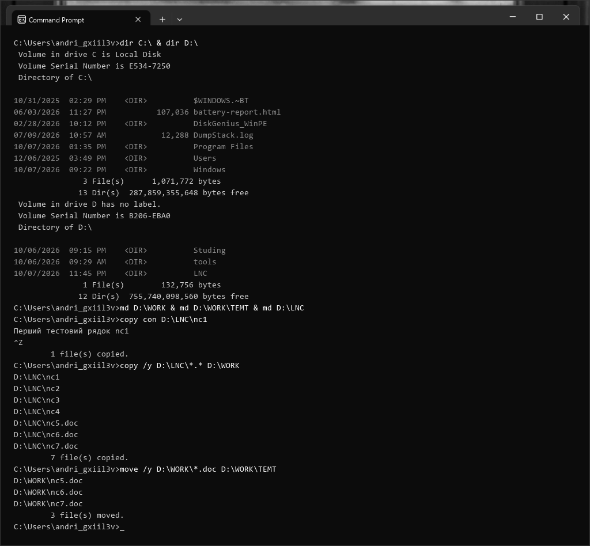
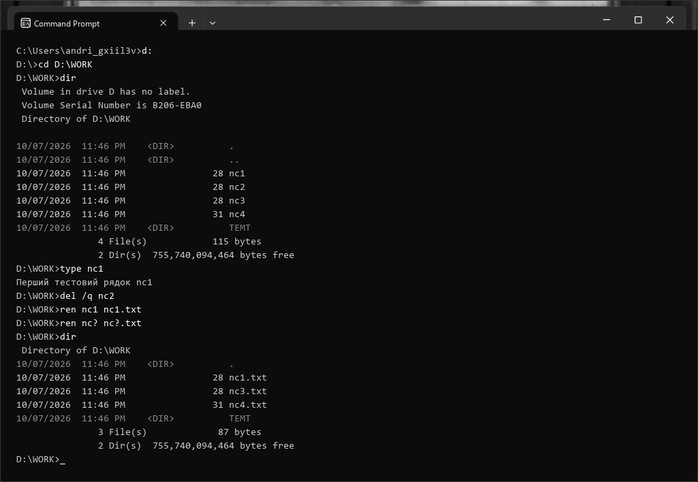
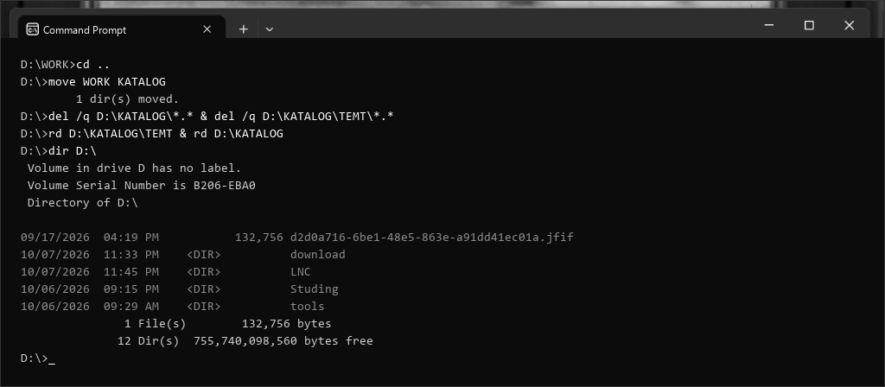
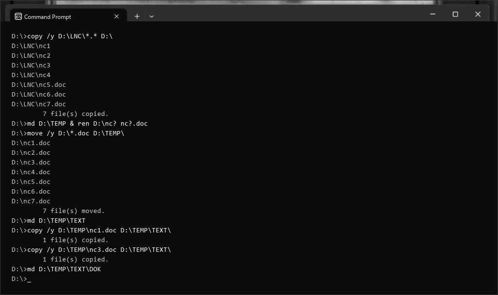
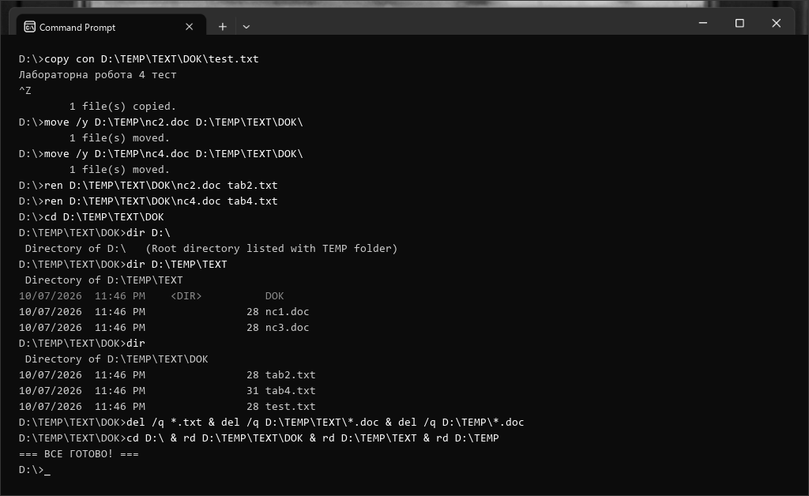

# МІНІСТЕРСТВО ОСВІТИ І НАУКИ УКРАЇНИ
## НАЦІОНАЛЬНИЙ УНІВЕРСИТЕТ «ЛЬВІВСЬКА ПОЛІТЕХНІКА»
### Кафедра «Систем автоматизованого проектування»

<br>

## ЗВІТ
### до лабораторної роботи №4
### з дисципліни «Операційні системи»
### на тему: «Внутрішні команди консольного режиму Windows для роботи з файлами та каталогами»

<br>

**Виконав:**  
студент групи ПП-14  
**Лемішка Андрій**  

**Перевірила:**  
викладач кафедри САПР  
**Нестор Н. І.**  

<br>

**Львів – 2026**

---

# Лабораторна робота №4
## Тема: Внутрішні команди консольного режиму Windows для роботи з файлами та каталогами

**Мета роботи:** набути практичні навички з використання основних команд консольного режиму операційної системи Windows для роботи з файлами та каталогами.

**Обладнання та програмне забезпечення:** Персональний комп'ютер під управлінням операційної системи Microsoft Windows 11 Pro, інтерпретатор командного рядка Windows (cmd.exe), термінальне середовище Windows Terminal.

---

## Хід роботи

### Завдання 1. Ознайомлення зі структурою файлової системи дисків та роботою внутрішніх команд консольного режиму ОС Windows

Метою першого блоку завдань є дослідження структури дисків `C:` та `D:`, вивчення синтаксису командного процесора Windows, створення ієрархій каталогів, інтерактивне створення файлів через консольний потік `CON`, копіювання, сортування та переміщення файлів за шаблонами масок.

#### Послідовність виконання кроків 1–8:
1. **Перегляд дерева каталогів дисків:** Перевірено вміст системного диска `C:` та накопичувача `D:`:
   ```cmd
   dir C:   dir D:   ```
2. **Створення підкаталогу `WORK`:** У кореневому каталозі диска `D:` створено нову робочу директорію:
   ```cmd
   md D:\WORK
   ```
3. **Створення підкаталогу `TEMT`:** Усередині каталогу `WORK` створено підкаталог для тимчасових документів:
   ```cmd
   md D:\WORK\TEMT
   ```
4. **Перевірка каталогу `LNC`:** Виконано перегляд каталогу `LNC`:
   ```cmd
   dir D:\LNC
   ```
5. **Створення каталогу `LNC`:** Оскільки каталог був відсутній, його створено командою:
   ```cmd
   md D:\LNC
   ```
6. **Створення тестових текстових файлів через `copy con`:** За допомогою пристрою консольного введення `CON` створено 7 файлів (`nc1`–`nc4` без розширення та `nc5.doc`–`nc7.doc`). Після введення тексту натиснуто `Ctrl + Z` (`^Z`) та `Enter`:
   ```cmd
   copy con D:\LNC
c1
   copy con D:\LNC
c2
   copy con D:\LNC
c3
   copy con D:\LNC
c4
   copy con D:\LNC
c5.doc
   copy con D:\LNC
c6.doc
   copy con D:\LNC
c7.doc
   ```
7. **Копіювання всіх файлів:** Усі файли з `D:\LNC` скопійовано у робочий каталог `D:\WORK` за універсальним шаблоном `*.*`:
   ```cmd
   copy D:\LNC\*.* D:\WORK
   ```
   *(Скопійовано 7 файлів).*
8. **Переміщення файлів з розширенням `.doc`:** Усі документи з розширенням `.doc` переміщено з `WORK` у підкаталог `TEMT`:
   ```cmd
   move D:\WORK\*.doc D:\WORK\TEMT
   ```
   *(Переміщено 3 файли: nc5.doc, nc6.doc, nc7.doc).*


*Рис. 1.1. Перегляд дисків, створення структури каталогів LNC/WORK/TEMT, створення файлів через copy con та операції копіювання і переміщення*

---

#### Послідовність виконання кроків 9–16:
9. **Перехід на диск `D:`:** Змінено поточний активний диск:
   ```cmd
   D:
   ```
10. **Вхід у робочий каталог `WORK`:** Здійснено навігацію в каталог `WORK`:
    ```cmd
    cd D:\WORK
    ```
11. **Перегляд вмісту каталогу:** Виведено лістинг поточної директорії:
    ```cmd
    dir
    ```
    *(Каталог містить файли nc1, nc2, nc3, nc4 та підкаталог TEMT).*
12. **Перегляд вмісту текстового файлу:** Виведено текст файлу `nc1` на екран термінала:
    ```cmd
    type nc1
    ```
13. **Знищення файлу `nc2`:** Вилучено файл `nc2` за допомогою команди:
    ```cmd
    del nc2
    ```
14. **Перейменування одиничного файлу:** Файлу `nc1` присвоєно розширення `.txt`:
    ```cmd
    ren nc1 nc1.txt
    ```
15. **Групове перейменування за маскою:** За допомогою символу підстановки `?` перейменовано решту файлів:
    ```cmd
    ren nc? nc?.txt
    ```
    *(Файли nc3 та nc4 перейменовано у nc3.txt та nc4.txt).*
16. **Контрольний перегляд:** Перевірено результат виконання операцій:
    ```cmd
    dir
    ```
    *(Зафіксовано файли: nc1.txt, nc3.txt, nc4.txt та підкаталог TEMT).*


*Рис. 1.2. Навігація в каталог WORK, перегляд вмісту файлу, видалення та групове перейменування файлів*

---

#### Послідовність виконання кроків 17–21:
17. **Перехід у надкаталог:** Здійснено вихід на один рівень вище в кореневий каталог:
    ```cmd
    cd ..
    ```
18. **Перейменування каталогу `WORK`:** За допомогою команди `move` змінено назву директорії `WORK` на `KATALOG`:
    ```cmd
    move WORK KATALOG
    ```
    *(Виведено: 1 dir(s) moved).*
19. **Знищення файлів та видалення вкладеного каталогу:** Послідовно видалено всі файли в `KATALOG` та вкладеному `TEMT`, після чого видалено порожній підкаталог `TEMT`:
    ```cmd
    del D:\KATALOG\*.*
    del D:\KATALOG\TEMT\*.*
    rd D:\KATALOG\TEMT    ```
20. **Знищення каталогу `KATALOG`:** Оскільки каталог `KATALOG` повністю звільнений від файлів і підпапок, його остаточно видалено:
    ```cmd
    rd D:\KATALOG
    ```
21. **Контрольний перегляд кореня диска `D:`:** Виведено вміст диска `D:` для перевірки результату:
    ```cmd
    dir D:    ```
    *(Каталоги WORK та KATALOG повністю відсутні).*


*Рис. 1.3. Перейменування каталогу (move), видалення вмісту та каталогів (del, rd) і перевірка кореня диска*

---

### Завдання 2. Самостійне виконання комплексу операцій з файлами та ієрархічними каталогами

У другому завданні самостійно сформульовано та реалізовано послідовність внутрішніх команд командного процесора Windows для побудови багаторівневої структури каталогів `TEMP\TEXT\DOK`, фільтрації за розширеннями, переміщення та перейменування файлів, а також подальшого коректного очищення файлової системи.

#### Послідовність виконання кроків 1–7:
1. **Копіювання файлів з `LNC` у корінь диска `D:`:**
   ```cmd
   copy D:\LNC\*.* D:   ```
   *(Скопійовано 7 файлів: nc1, nc2, nc3, nc4, nc5.doc, nc6.doc, nc7.doc).*
2. **Створення підкаталогу `TEMP`:**
   ```cmd
   md D:\TEMP
   ```
3. **Групове надання розширення `.doc` файлам `nc?`:**
   ```cmd
   ren D:
c? nc?.doc
   ```
4. **Переміщення всіх файлів `.doc` у каталог `TEMP`:**
   ```cmd
   move D:\*.doc D:\TEMP   ```
   *(Переміщено всі 7 файлів у папку TEMP).*
5. **Створення підкаталогу `TEXT` усередині `TEMP`:**
   ```cmd
   md D:\TEMP\TEXT
   ```
6. **Копіювання файлів `nc1.doc` та `nc3.doc` у каталог `TEXT`:**
   ```cmd
   copy D:\TEMP
c1.doc D:\TEMP\TEXT   copy D:\TEMP
c3.doc D:\TEMP\TEXT   ```
7. **Створення вкладеного підкаталогу `DOK` усередині `TEXT`:**
   ```cmd
   md D:\TEMP\TEXT\DOK
   ```


*Рис. 2.1. Створення ієрархічної структури TEMP\TEXT\DOK, групові операції копіювання, перейменування та сортування файлів*

---

#### Послідовність виконання кроків 8–13:
8. **Створення тестового файлу безпосередньо в каталозі `DOK`:**
   ```cmd
   copy con D:\TEMP\TEXT\DOK	est.txt
   ```
   *(Введено текстовий рядок, збережено комбінацією Ctrl + Z та Enter).*
9. **Перенесення файлів `nc2.doc` та `nc4.doc` у каталог `DOK`:**
   ```cmd
   move D:\TEMP
c2.doc D:\TEMP\TEXT\DOK   move D:\TEMP
c4.doc D:\TEMP\TEXT\DOK   ```
10. **Перейменування файлів у каталозі `DOK` на `tab2.txt` та `tab4.txt`:**
    ```cmd
    ren D:\TEMP\TEXT\DOK
c2.doc tab2.txt
    ren D:\TEMP\TEXT\DOK
c4.doc tab4.txt
    ```
11. **Перегляд трьох рівнів ієрархії з поточного каталогу:**
    ```cmd
    cd D:\TEMP\TEXT\DOK
    dir D:    dir D:\TEMP\TEXT
    dir
    ```
12. **Знищення файлів з розширеннями `.txt` та `.doc`:**
    ```cmd
    del D:\TEMP\TEXT\DOK\*.txt
    del D:\TEMP\TEXT\*.doc
    del D:\TEMP\*.doc
    ```
13. **Послідовне знищення каталогів `DOK`, `TEXT` та `TEMP`:**
    ```cmd
    cd D:    rd D:\TEMP\TEXT\DOK
    rd D:\TEMP\TEXT
    rd D:\TEMP
    ```


*Рис. 2.2. Створення тестового файлу, переміщення у вкладений підкаталог DOK, перегляд рівнів ієрархії та повне очищення каталогів*

---

## Висновок

Під час виконання лабораторної роботи №4 було успішно опановано фундаментальні принципи функціонування консольного режиму операційної системи Windows (інтерпретатор `cmd.exe`) та практично відпрацьовано навички роботи з внутрішніми командами управління файловою системою.

У процесі дослідження було детально опрацьовано архітектурну відмінність між внутрішніми командами, які вбудовані безпосередньо в кодове тіло інтерпретатора (`cd`, `md`, `rd`, `dir`, `copy`, `move`, `del`, `ren`, `type`) і не потребують завантаження сторонніх файлів з диска, та зовнішніми системними утилітами. Було закріплено роботу з метасимволами групової підстановки (`*` та `?`), що дозволило ефективно здійснювати масові операції перейменування (`ren nc? nc?.doc`), копіювання та видалення файлів заданих масок.

Практично досліджено механіку створення текстових документів засобами консолі без застосування графічних або сторонніх редакторів через псевдопристрій клавіатури `copy con` та генерацію маркерів EOF (`^Z`). Особливу увагу було приділено особливостям ієрархічної навігації (`cd ..`, `cd \`), відмінностям між фізичним переміщенням файлів (`move`) та копіюванням (`copy`), а також обов'язковим правилам безпечного видалення каталогів командою `rd`, що вимагає попереднього повного очищення файлового вмісту та підкаталогів нижчих рівнів.

Набуті практичні компетентності є базовими для написання командних сценаріїв пакетної автоматизації (файли `.bat` та `.cmd`), системного адміністрування робочих станцій та серверних середовищ сімейства Microsoft Windows.

---

## Відповіді на контрольні запитання

### 1. Що таке специфікація файлу?
**Специфікація файлу** (*file specification*, або повне кваліфіковане ім'я файлу) — це вичерпний опис місцезнаходження та найменування файлу у файловій системі, який однозначно ідентифікує його для операційної системи. Повна специфікація включає:
- ім'я логічного пристрою/диска з двокрапкою (наприклад, `C:` або `D:`);
- символ кореневого каталогу (`\`);
- ланцюжок імен батьківських каталогів та підкаталогів, розділених символом `\` (шлях);
- власне базове ім'я файлу;
- розширення файлу, що відокремлюється крапкою (наприклад, `.txt`, `.doc`).  
*Приклад повної специфікації:* `D:\WORK\TEMT\nc5.doc`.

### 2. Правила іменування файлів.
У класичній ОС MS-DOS використовувалося правило **8.3**: ім'я файлу містило від 1 до 8 символів, крапку та необов'язкове розширення до 3 символів.  
У сучасних операційних системах Windows (файлові системи NTFS та FAT32 з підтримкою LFN — Long File Names) діють такі правила:
1. Довжина імені файлу може сягати до 255 символів.
2. Повний шлях до файлу (MAX_PATH) обмежений 260 символами (або до 32767 символів з префіксом `\\?\`).
3. Регістр символів зберігається, але не враховується при пошуку та виконанні (case-insensitive).
4. В іменах **заборонено** використовувати службові спецсимволи: `\`, `/`, `:`, `*`, `?`, `"`, `<`, `>`, `|`.
5. **Заборонено** використовувати зарезервовані системні імена пристроїв: `CON`, `PRN`, `AUX`, `NUL`, `COM1`–`COM9`, `LPT1`–`LPT9` (навіть із довільними розширеннями).

### 3. На які групи підрозділяються всі команди ОС MS-DOS.
Усі команди поділяються на дві основні групи:
1. **Внутрішні команди (internal):** програмний код цих команд розміщений безпосередньо всередині командного процесора (`COMMAND.COM` у MS-DOS або `cmd.exe` у Windows). Вони завантажуються в оперативну пам'ять разом з інтерпретатором під час запуску системи, тому виконуються миттєво без звернення до диску. Приклади: `dir`, `cd`, `md`, `rd`, `copy`, `ren`, `del`, `type`, `cls`, `exit`.
2. **Зовнішні команди (external):** це окремі файли програм та утиліт, які зберігаються на диску як виконувані модулі з розширеннями `.COM`, `.EXE` або командні файли `.BAT`. Для їхнього виконання командний інтерпретатор повинен знайти файл на накопичувачі, завантажити його в оперативну пам'ять і передати йому управління. Приклади: `format.com`, `chkdsk.exe`, `xcopy.exe`, `tree.com`, `diskcopy.com`, `find.exe`.

### 4. Як працюють команди ОС MS-DOS?
Робота командного процесора реалізована за замкненим циклом:
1. **Виведення запрошення (prompt):** інтерпретатор відображає на екрані поточний диск та шлях (наприклад, `D:\WORK>`).
2. **Очікування введення:** користувач вводить командний рядок з клавіатури до натискання клавіші `Enter`.
3. **Лексичний аналіз (парсинг):** інтерпретатор розбиває введений рядок на ім'я команди, ключі (що починаються з `/`) та позиційні параметри/аргументи.
4. **Пошук та виклик:**
   - Спочатку перевіряється внутрішня таблиця команд. Якщо знайдено — викликається вбудована підпрограма в пам'яті.
   - Якщо це не внутрішня команда, інтерпретатор шукає виконуваний файл у поточному каталозі.
   - Якщо в поточному каталозі файл відсутній, здійснюється послідовний пошук по всіх директоріях, зазначених у системній змінній оточення `PATH`.
5. **Виконання та повернення управління:** програма виконується, формує код виходу (ERRORLEVEL), після чого командний рядок повертається до початкового очікування.

### 5. Що таке шлях до файлу?
**Шлях до файлу** (*path*) — це маршрут відправної точки файлової структури до потрібного каталогу або файлу, записаний у вигляді послідовності імен папок, розділених символом зворотного слеша `\`.
- **Абсолютний шлях:** починається від кореневого каталогу зазначеного диска (наприклад, `D:\TEMP\TEXT\DOK\test.txt`). Є однозначним з будь-якого місця системи.
- **Відносний шлях:** відраховується від поточного робочого каталогу користувача (наприклад, `TEXT\DOK\test.txt` або `..\tab2.txt`).

### 6. Призначення символу <..> і <\> у записі шляху.
- **Символ `\` (зворотний слеш):**
  1. Якщо вказаний на початку шляху (наприклад, `cd \`), позначає **кореневий каталог** поточного диска.
  2. Якщо стоїть між іменами каталогів, виконує роль обов'язкового **роздільника** рівнів ієрархії.
- **Символ `..` (дві крапки):**
  Позначає посилання на **батьківський каталог** (надкаталог), тобто каталог, розташований рівнем вище по дереву файлової системи (наприклад, `cd ..` піднімає на рівень вище; `..\каталог` адресує сусідній каталог на рівень вище).

### 7. Як задати шаблон групи файлів в команді?
Шаблон (маска файлів, *wildcard*) задається за допомогою метасимволів підстановки:
- **`*` (зірочка):** замінює будь-яку кількість довільних символів (включаючи 0 символів) у базовому імені або розширенні файлу (наприклад, `*.doc` — усі файли Word; `nc*.*` — усі файли з префіксом nc).
- **`?` (знак питання):** замінює строго один будь-який символ на конкретній позиції (наприклад, `nc?` позначає `nc1`, `nc2`, але не позначає `nc12`; `tab?.txt` — файли типу `tab2.txt`).

### 8. Які команди консольного режиму можуть робити з групою файлів?
З групами файлів за допомогою шаблонів (`*` та `?`) можуть працювати практично всі основні команди маніпуляції даними:
- `dir` — лістинг файлів, що відповідають масці (наприклад, `dir *.txt`);
- `copy` — копіювання групи файлів у цільову папку (наприклад, `copy D:\LNC\*.* D:\WORK`);
- `move` — переміщення групи файлів за шаблоном (наприклад, `move D:\WORK\*.doc D:\WORK\TEMT`);
- `del` (або `erase`) — масове видалення файлів (наприклад, `del *.doc` або `del *.*`);
- `ren` (або `rename`) — групове перейменування імен чи розширень (наприклад, `ren nc? nc?.doc`);
- `attrib` — зміна атрибутів (читання, прихований, системний) для групи файлів;
- `fc` / `comp` — порівняння групи файлів;
- `xcopy` — розширене деревоподібне копіювання файлових груп.

### 9. Призначення команди dir.
Команда **`dir`** (*Directory*) призначена для відображення списку файлів та підкаталогів, розташованих на вказаному диску або у робочій директорії. Для кожного елемента лістингу відображаються:
- дата та час останньої модифікації;
- ознака підкаталогу `<DIR>` або розмір файлу в байтах;
- власне ім'я файлу або папки;
- підсумкова системна статистика: сумарна кількість файлів і зайнятий ними простір, кількість папок, а також залишок вільного місця на накопичувачі в байтах.

### 10. Призначення параметрів [/P] і [/W] у записі команди dir.
- **`/P` (Page):** вмикає посторінковий режим виведення. Якщо список файлів перевищує розмір вікна термінала, лістинг призупиняється внизу кожного екрана та очікує натискання клавіші користувачем (*«Press any key to continue . . .»*), що запобігає втраті інформації внаслідок швидкого скролінгу.
- **`/W` (Wide):** вмикає широкоформатний режим виведення у кілька стовпчиків горизонтально. Відображаються виключно назви файлів та каталоги у форматі `[DIR]`, приховуючи метадані розмірів, дати та часу, що дозволяє компактно переглянути велику кількість записів на одному екрані.

### 11. Призначення команд md, rd.
- **`md` (або `mkdir` — Make Directory):** внутрішня команда створення нового каталогу або багаторівневої структури каталогів за заданим шляхом (наприклад, `md D:\WORK\TEMT`).
- **`rd` (або `rmdir` — Remove Directory):** внутрішня команда видалення (знищення) існуючого каталогу. Згідно з класичними системними правилами:
  1. Каталог, що видаляється, обов'язково повинен бути **порожнім** (не містити файлів і підкаталогів).
  2. Каталог не повинен бути поточним або кореневим.

### 12. Призначення команд cd.
Команда **`cd`** (*chdir — Change Directory*) призначена для перегляду та зміни поточного робочого каталогу:
- `cd` (без параметрів) — виводить повний шлях до поточної директорії;
- `cd <шлях>` — виконує перехід у зазначений каталог на поточному диску;
- `cd ..` — виконує перехід у батьківський каталог на один рівень вгору;
- `cd \` — виконує миттєвий перехід у корінь поточного диска;
- `cd /d <шлях>` — виконує перехід у каталог з одночасною зміною активного диска (у сучасному Windows cmd).

### 13. Призначення команд copy, move.
- **`copy`:** копіює один або декілька файлів із джерела в місце призначення. Оригінальні файли залишаються без змін у початковому каталозі. Команда також підтримує об'єднання кількох файлів у один (`copy f1+f2 f3`) та створення нових текстових файлів з клавіатури (`copy con filename`).
- **`move`:** переміщує файли або каталоги з одного місця в інше. Після виконання файли вилучаються з вихідної директорії. Крім того, команда `move` дозволяє перейменовувати каталоги (наприклад, `move WORK KATALOG`), чого не підтримує класична команда `ren`.

### 14. Призначення команд type, ren, del.
- **`type`:** виводить текстовий вміст зазначеного файлу безпосередньо у вікно командного рядка (на екран). Застосовується для швидкого перегляду текстових файлів (ASCII, ANSI, `.txt`, `.bat`).
- **`ren` (або `rename`):** перейменовує файл або групу файлів за шаблоном. Змінює лише ім'я чи розширення в межах того самого каталогу (не може переміщувати файли в іншу папку).
- **`del` (або `erase`):** безповоротно вилучає один, декілька або всі файли за заданим шаблоном із поточної чи зазначеної папки. Ключ `/P` запитує підтвердження на видалення кожного файлу.

### 15. Призначення команди copy con.
Команда **`copy con <ім'я_файлу>`** призначена для швидкого інтерактивного створення текстового файлу безпосередньо з консолі:
1. Як джерело копіювання виступає спеціальний системний псевдопристрій консолі **`CON`** (клавіатура), а як приймач — створюваний файл на диску.
2. Після запуску команди командний рядок переходить у режим очікування введення рядків тексту з клавіатури.
3. Для збереження файлу та виходу з режиму введення користувач надсилає системний сигнал кінця файлу **EOF** (*End of File*) за допомогою комбінації клавіш **`Ctrl + Z`** (на екрані з'являється символ `^Z`) та натискає **`Enter`**.
4. Інтерпретатор фіксує успішне створення файлу повідомленням `1 file(s) copied.` (або `Скопійовано файлів: 1`).
