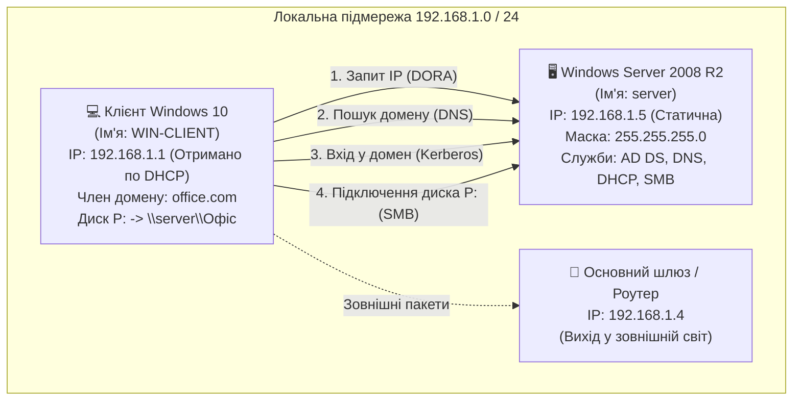
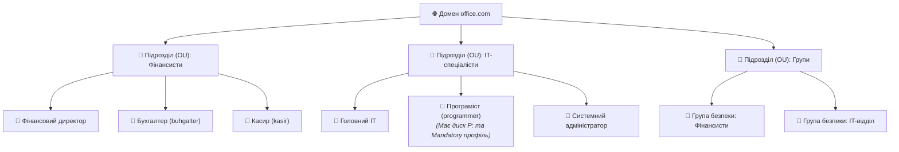

# 📘 МЕТОДИЧНИЙ ПОСІБНИК ДЛЯ ПІДГОТОВКИ ДО ЗАХИСТУ ЛАБОРАТОРНОЇ РОБОТИ №5
## «Розгортання та адміністрування інфраструктури Active Directory, DNS, DHCP, GPO та робочої станції Windows 10 у Windows Server»

**Дисципліна:** Операційні системи  
**Кафедра:** Систем автоматизованого проектування (САПР), Національний університет «Львівська політехніка»  
**Студент:** Андрій ЛЕМІШКА (група ПП-14)  
**Викладач:** Наталія НЕСТОР  
**Навчальний рік:** 2026  

---

## 📋 ЗМІСТ МЕТОДИЧКИ

1. [Вступ: мета, завдання та концепція лабораторної роботи](#1-вступ-мета-завдання-та-концепція-роботи)
2. [Карта та паспорт нашої інфраструктури (office.com)](#2-карта-та-паспорт-нашої-інфраструктури)
3. [Теоретичний базис "на пальцях" (з життєвими аналогіями)](#3-теоретичний-базис-на-пальцях)
4. [Анатомія налаштувань: "Чому кожен крок робився саме так?"](#4-анатомія-налаштувань-чому-кожен-крок-робився-саме-так)
5. [Екзаменаційний практикум: 20 реальних запитань викладача з розгорнутими відповідями](#5-екзаменаційний-практикум-20-запитань-викладача)
6. [Швидкий траблшутинг: що робити, якщо на захисті щось не спрацювало](#6-швидкий-траблшутинг-на-випадок-збоїв)
7. [Шпаргалка гарячих консолей Windows Server (MMC Snap-ins)](#7-шпаргалка-гарячих-консолей-windows-server)

---

## 1. ВСТУП: МЕТА, ЗАВДАННЯ ТА КОНЦЕПЦІЯ РОБОТИ

### 🎯 Яка головна мета цієї роботи?
Уявіть, що ви прийшли системним адміністратором у компанію з 100 працівниками. Якщо там немає сервера, то при зміні пароля чи звільненні працівника вам доведеться обходити всі 100 комп'ютерів ніжками. 

**Мета Лабораторної №5** — створити **єдиний центр керування (Active Directory)** на Windows Server 2008 R2, де:
1. Усі комп'ютери та користувачі підпорядковуються єдиному домену **`office.com`**.
2. Вхід користувачів на будь-якому комп'ютері перевіряється централізовано.
3. Мережеві адреси комп'ютерам роздаються автоматично через **DHCP**.
4. Спільні документи зберігаються на захищеній мережевій папці **`\\server\Офіс`**.
5. Налаштування безпеки (блокування екрана) автоматично розсилаються на комп'ютери через **групові політики (GPO)**.

---

## 2. КАРТА ТА ПАСПОРТ НАШОЇ ІНФРАСТРУКТУРИ

### 🗺️ Схема взаємодії компонентів



### 📊 Паспорт мережевих налаштувань

| Параметр | Значення на Сервері | Значення на Клієнті (Windows 10) | Чому саме так? |
| :--- | :--- | :--- | :--- |
| **Операційна система** | Windows Server 2008 R2 Enterprise | Windows 10 Pro | Сервер керує, клієнт підпорядковується |
| **IP-адреса** | `192.168.1.5` | `192.168.1.1` | Серверу — постійна адреса, клієнту — з пулу DHCP |
| **Спосіб отримання IP** | Статично (вручну вбито) | Динамічно (автоматично від DHCP) | Клієнти не повинні конфліктувати між собою |
| **Маска підмережі** | `255.255.255.0` (`/24`) | `255.255.255.0` (`/24`) | Єдина підмережа на 254 робочі комп'ютери |
| **Основний шлюз** | `192.168.1.4` | `192.168.1.4` (видано DHCP) | Адреса роутера для виходу за межі підмережі |
| **DNS-сервер** | `192.168.1.5` (або `127.0.0.1`) | `192.168.1.5` (видано DHCP) | Контролер домену сам є сервером DNS |
| **Домен** | `office.com` | `office.com` | Спільний простір імен компанії |

### 👥 Штатний розпис створеного підприємства `office.com`



---

## 3. ТЕОРЕТИЧНИЙ БАЗИС "НА ПАЛЬЦЯХ"

### 3.1. Що таке IP-адреса, Маска та Шлюз?
* **IP-адреса (`192.168.1.5`):** Це як **поштова адреса або номер квартири**. Щоб один комп'ютер передав іншому файл, він має знати цифровий номер отримувача. Складається з 4 чисел (байтів), кожне від 0 до 255.
* **Маска підмережі (`255.255.255.0`):** Це **трафарет**, який показує, де закінчується назва вулиці і починається номер будинку:
  * Три числа `255.255.255.` показують: назва нашої спільної вулиці — `192.168.1.`;
  * Останнє число `.0` каже: номери комп'ютерів на цій вулиці можуть бути від `1` до `254`.
* **Основний шлюз (`192.168.1.4`):** Це **вихідні двері з кімнати на вулицю (роутер)**. Якщо комп'ютер хоче звернутися до сайту в Інтернеті чи іншої підмережі, він віддає пакет шлюзу, а той пересилає його далі.

### 3.2. Що таке DNS (Domain Name System)?
* **Життєва аналогія:** Телефонна книга у вашому смартфоні.
* Людям важко запам'ятовувати цифри `192.168.1.5`, нам простіше сказати `office.com` або `server`.
* **DNS** — це служба-перекладач. Коли ви пишете ім'я `office.com`, DNS перекладає його в число `192.168.1.5`. Без DNS Windows 10 ніколи не знайде свій сервер.

### 3.3. Що таке DHCP (Dynamic Host Configuration Protocol)?
* **Життєва аналогія:** Адміністратор на рецепції готелю.
* Коли новий комп'ютер вмикається в мережу, він не знає своєї адреси. Служба DHCP автоматично видає йому вільну IP-адресу в тимчасову оренду (наприклад, на 8 днів), а також повідомляє маску, шлюз і DNS.
* Працює за 4 кроки **DORA**:
  1. **Discover** (Клієнт кричить: *«Хто тут роздає IP?»*);
  2. **Offer** (Сервер пропонує: *«Тримай 192.168.1.1»*);
  3. **Request** (Клієнт погоджується: *«Беру саме твою адресу!»*);
  4. **Acknowledge** (Сервер підтверджує оренду).

### 3.4. Що таке Active Directory Domain Services (AD DS)?
* **Життєва аналогія:** Єдиний паспортний стіл компанії.
* Замість створення користувача на кожному ПК окремо, Active Directory створює **єдину базу даних (файл `ntds.dit`) на сервері**. Тепер працівник може підійти до будь-якого вільного комп'ютера в офісі, ввести свій логін/пароль — і система впустить його, підтягне його файли та налаштування.

---

## 4. АНАТОМІЯ НАЛАШТУВАНЬ: "ЧОМУ КОЖЕН КРОК РОБИВСЯ САМЕ ТАК?"

Цей розділ пояснює логіку кожного вашого кліку мишкою в лабораторній роботі:

### ❓ Крок 1: Чому серверу призначили статичний IP вручну?
* **Чому:** Сервер — це якір мережі. Служба DNS записує: *«Сервер лежить на 192.168.1.5»*. Якщо адреса зміниться динамічно, записи в DNS стануть недійсними, клієнти втратять сервер, і домен розвалиться.

### ❓ Крок 2: Чому домен називається саме `office.com`, а не просто `office`?
* **Чому:** Стандарт Active Directory вимагає використання системи доменних імен Інтернету (FQDN — Fully Qualified Domain Name), яка складається мінімум із двох частин через крапку: ім'я домену (`office`) + коренева зона (`.com` або `.local`). Без крапки DNS не зможе побудувати ієрархічне дерево записів.

### ❓ Крок 3: Чому створювали Організаційні підрозділи (OU), а не користувалися стандартною папкою Users?
* **Чому:** Стандартна папка `CN=Users` — це системний контейнер, до якого **неможливо прив'язати Групову політику (GPO)** і неможливо делегувати права. Організаційні підрозділи (OU) створюються спеціально для того, щоб на них діяли політики безпеки.

### ❓ Крок 4: Чому користувачів об'єднали в Групи безпеки (Security Groups)?
* **Чому (Золоте правило AGDLP):** Адміністратори ніколи не роздають права доступу окремим людям! Якщо у відділі 20 бухгалтерів, призначати права кожному окремо — груба помилка. Створюється група `Фінансисти`, їй дається доступ до папки, а вже в групу додаються люди. Коли приходить новий бухгалтер — його просто закидають у групу, і він автоматично отримує всі потрібні права.

### ❓ Крок 5: Чому права на папку налаштовуються у двох місцях: "Доступ" (Share) та "Безпека" (NTFS)?
* **Чому:** 
  * Вкладка **«Доступ» (SMB Share)** регулює прохід через мережевий кабель.
  * Вкладка **«Безпека» (NTFS)** регулює права на локальному жорсткому диску сервера.
  * **Правило перетину:** Діє **найбільш жорстке обмеження**:
    $$\text{Підсумковий доступ} = \min(\text{Share}, \text{NTFS})$$
    *Приклад:* Якщо в Share стоїть «Тільки читання», а в NTFS «Повний доступ» — користувач через мережу зможе **тільки читати**.

### ❓ Крок 6: Що таке Диск `P:\` і як він з'явився у програміста?
* **Чому:** У властивостях користувача Програміст у вкладці *Профіль (Profile)* вказано: *Підключити диск P: до шляху `\\server\Офіс`*. Коли програміст входить на будь-якому ПК у домені, Windows автоматично монтує мережеву папку як звичайний локальний диск `P:`.

### ❓ Крок 7: Що робить перейменування файлу на `NTUSER.MAN`?
* **Чому:** Файл `NTUSER.DAT` зберігає персональні налаштування реєстру користувача. Якщо розширення змінити на `.MAN` (Mandatory — обов'язковий), операційна система переходить у режим «тільки для читання». Будь-які зміни (створені файли, збережені паролі, зміна шпалер) **знищуються при виході з системи**.

### ❓ Крок 8: Що робить Групова політика (GPO) «Фінансова безпека»?
* **Чому:** Вона застосовується до підрозділу «Фінансисти» і вмикає таймер заставки екрана на **600 секунд (10 хвилин)** із вимогою введення пароля для розблокування. Якщо фінансист відійшов пити каву — конфіденційні звіти автоматично сховаються від сторонніх очей.

### ❓ Крок 9: Навіщо авторизувати DHCP в Active Directory?
* **Чому:** Щоб захиститися від шпигунських роутерів (Rogue DHCP). Якщо студент або хакер встромить у розетку свій роутер, той почне видавати комп'ютерам підроблений шлюз і перехоплювати паролі. Active Directory дозволяє роздавати IP лише тим DHCP-серверам, які адміністратор авторизував у домені.

### ❓ Крок 10: Що відбувається під час введення Windows 10 у домен?
* **Чому:**
  1. Комп'ютер запитує у DNS, хто тут контролер домену `office.com`.
  2. Знаходить сервер `192.168.1.5` через SRV-запис `_ldap`.
  3. В базі Active Directory створюється обліковий запис комп'ютера **`WIN-CLIENT$`**.
  4. Між клієнтом і сервером створюється постійний шифрований канал довіри (**Secure Channel**).
  5. Група `office\Domain Admins` автоматично додається в локальну групу адміністраторів на Windows 10.

---

## 5. ЕКЗАМЕНАЦІЙНИЙ ПРАКТИКУМ: 20 ЗАПИТАНЬ ВИКЛАДАЧА

### Блок А. Базові мережеві питання

#### 1. Що таке IP-адреса і скільки біт вона містить у версії IPv4?
* **Відповідь:** Це логічний числовий ідентифікатор пристрою на 3-му (мережевому) рівні OSI. У версії IPv4 адреса містить **32 біти (4 байти)**, розділені крапками на 4 октети (від 0 до 255). Приклад: `192.168.1.5`.

#### 2. Чим відрізняється біла (публічна) IP-адреса від сірої (приватної)?
* **Відповідь:** Біла адреса глобально маршрутизується в Інтернеті і є унікальною у світі. Сіра (приватна) адреса (як наша `192.168.1.x`) діє тільки всередині локальної мережі підприємства і не виходить в Інтернет без технології NAT на роутері.

#### 3. Що таке петльова адреса 127.0.0.1 (Loopback / localhost)?
* **Відповідь:** Це спеціальна адреса комп'ютера «на самого себе». Пакети на `127.0.0.1` не йдуть у мережевий кабель, а розвертаються всередині операційної системи для перевірки мережевих служб.

#### 4. Що таке Основний шлюз (Default Gateway)?
* **Відповідь:** Це адреса маршрутизатора (`192.168.1.4`), на яку надсилаються всі пакети, якщо адресат знаходиться за межами поточної локальної підмережі.

#### 5. Яка різниця між IP-адресою та MAC-адресою?
* **Відповідь:** MAC-адреса (48 біт) — це фізичний апаратний номер мережевої карти, «зашитий» на заводі (паспорт пристрою). IP-адреса (32 біти) — це логічна тимчасова адреса, яка залежить від мережі, куди комп'ютер підключено.

---

### Блок Б. Служби DNS та DHCP

#### 6. Яку функцію виконує служба DNS у доменній мережі?
* **Відповідь:** Вона перетворює людиночитабельні доменні імена (`office.com`) на цифрові IP-адреси (`192.168.1.5`). Без DNS клієнти не можуть знайти контролер домену.

#### 7. Що таке SRV-записи в DNS і навіщо вони потрібні Active Directory?
* **Відповідь:** Це службові записи в DNS (`_ldap`, `_kerberos`), які повідомляють клієнтам порти та імена серверів, що виконують роль контролерів домену.

#### 8. Які 4 кроки виконує протокол DHCP при видачі адреси?
* **Відповідь:** Протокол **DORA**:
  1. *Discover* — клієнт широкомовно шукає DHCP-сервер.
  2. *Offer* — сервер пропонує вільну IP-адресу.
  3. *Request* — клієнт підтверджує вибір запропонованої IP.
  4. *Acknowledge* — сервер підтверджує оренду і передає налаштування.

#### 9. Що таке Scope (Область) у службі DHCP?
* **Відповідь:** Це сконфігурований діапазон IP-адрес (у нас `192.168.1.1` — `192.168.1.100`), з якого сервер роздає адреси клієнтам у підмережі.

#### 10. Що станеться, якщо не авторизувати DHCP-сервер в Active Directory?
* **Відповідь:** Служба DHCP на Windows Server автоматично зупиниться і відмовиться видавати адреси клієнтам (захист від неавторизованих серверів).

---

### Блок В. Active Directory та безпека

#### 11. У чому різниця між Робочою групою (Workgroup) та Доменом (Domain)?
* **Відповідь:** У робочій групі автентифікація децентралізована (у кожного своя база SAM). У домені база користувачів єдина і централізована на контролері домену (база `ntds.dit`).

#### 12. Що таке Організаційний підрозділ (OU)?
* **Відповідь:** Це контейнер в Active Directory для логічного групування користувачів і комп'ютерів, на який можна призначати об'єкти групових політик (GPO).

#### 13. Який протокол автентифікації використовує Active Directory за замовчуванням?
* **Відповідь:** Протокол **Kerberos v5** (порт 88). Він працює на основі квитків (TGT) і не передає паролі мережею у відкритому вигляді.

#### 14. Чому Kerberos вимагає синхронізації часу між сервером і клієнтом (не більше 5 хвилин)?
* **Відповідь:** Для захисту від атак повторного відтворення (Replay Attack). Якщо перехоплений зловмисником квиток має застарілу мітку часу (>5 хв), сервер його відхиляє.

#### 15. Де фізично зберігається база даних Active Directory?
* **Відповідь:** У файлі `%SystemRoot%\NTDS\ntds.dit` на контролері домену на базі рушія Extensible Storage Engine (ESE).

---

### Блок Г. Практичні завдання та клієнт Windows 10

#### 16. Як обчислюється підсумковий доступ до спільної папки за наявності дозволів Share та NTFS?
* **Відповідь:** За правилом найбільш суворого обмеження: $\min(\text{Share}, \text{NTFS})$. Доступ надається лише тоді, коли він дозволений в обох списках одночасно.

#### 17. Що таке обов'язковий профіль (Mandatory Profile) і який файл за нього відповідає?
* **Відповідь:** Це профіль, зміни в якому не зберігаються на сервері при виході користувача. За нього відповідає файл конфігурації **`NTUSER.MAN`**.

#### 18. Що таке утиліта `runas` і який принцип безпеки вона реалізує?
* **Відповідь:** Вона дозволяє користувачеві запустити окрему програму від імені адміністратора (`runas /user:office\Administrator cmd`). Реалізує принцип найменших привілеїв (Least Privilege).

#### 19. Яка групова політика була створена в лабораторній роботі?
* **Відповідь:** Політика «Фінансова безпека», яка примусово вмикає блокування екрана (Screen Saver) через 600 секунд (10 хвилин) для підрозділу «Фінансисти».

#### 20. Як примусово оновити групові політики на клієнті Windows 10 без перезавантаження?
* **Відповідь:** За допомогою команди в командному рядку: **`gpupdate /force`**.

---

## 6. ШВИДКИЙ ТРАБЛШУТИНГ (НА ВИПАДОК ЗБОЇВ НА ЗАХИСТІ)

Якщо під час демонстрації перед викладачем щось пішло не так — не панікуйте, ось швидкі рішення:

| Симптом проблеми | Причина | Що зробити за 10 секунд |
| :--- | :--- | :--- |
| **Клієнт Windows 10 пише: «Не вдалося зв'язатися з контролером домену office.com»** | Клієнт втратив DNS-сервер або на сервері змінився IP | На клієнті зайти в `ncpa.cpl` $\rightarrow$ Властивості IPv4 $\rightarrow$ переконатися, що DNS вказано **`192.168.1.5`**. Перевірити команду `ping office.com`. |
| **Не монтується диск P: (`\\server\Офіс`)** | Немає доступу до мережевої папки або служба сервера спить | Перевірити, чи запущено сервер. У Провіднику ввести `\\192.168.1.5\Офіс`. Перевірити вкладку «Доступ» на сервері. |
| **Windows 10 не отримує IP-адресу по DHCP (видає 169.254.x.x)** | Служба DHCP не авторизована або Scope вимкнено | На сервері відкрити `dhcpmgmt.msc` $\rightarrow$ правою кнопкою на сервер $\rightarrow$ натиснути **Authorize** (Авторизувати). Перевірити, чи активовано пул (Activate Scope). |
| **Не спрацьовує групова політика блокування екрана** | Політика ще не встигла оновитися за розкладом | На клієнті відкрити CMD від імені адміністратора та ввести: `gpupdate /force`. |

---

## 7. ШПАРГАЛКА ГАРЯЧИХ КОНСОЛЕЙ WINDOWS SERVER

Натисніть `Win + R` на сервері та введіть будь-яку з цих команд, щоб миттєво відкрити потрібну оснастку перед очима викладача:

```text
dsa.msc      -> Користувачі та комп'ютери Active Directory (OU, люди, групи)
gpmc.msc     -> Керування груповими політиками (GPO)
dnsmgmt.msc  -> Менеджер DNS (прямі зони, записи A, SRV)
dhcpmgmt.msc -> Менеджер DHCP (пули IP, резервування за MAC)
compmgmt.msc -> Керування комп'ютером (спільні папки, диски)
ncpa.cpl     -> Мережеві підключення (перевірка IP та шлюзу)
cmd          -> Командний рядок (ipconfig /all, ping, gpupdate)
```

---

*Цей методичний посібник розроблено як персональний орієнтир для студента Андрія Лемішки. Володіння цим матеріалом гарантує спокійний, структурований і відмінний захист роботи!*
