# МІНІСТЕРСТВО ОСВІТИ І НАУКИ УКРАЇНИ
## НАЦІОНАЛЬНИЙ УНІВЕРСИТЕТ «ЛЬВІВСЬКА ПОЛІТЕХНІКА»
### Кафедра «Систем автоматизованого проектування»

 

## ЗВІТ
### до лабораторної роботи №6
### з дисципліни «Операційні системи»
### на тему: «Віддалений доступ в Linux»

 

**Виконав:**  
студент групи ПП-14  
**Лемішка Андрій**  

**Перевірив:**  
викладач кафедри САПР  
**Белей О. І.**  

 

**Львів – 2026**

---

# Лабораторна робота №6
## Тема: Віддалений доступ в Linux

**Мета роботи:** Ознайомитися на практиці із засобами віддаленого управління в операційній системі Linux Ubuntu. Набути досвіду і навички управління віддаленим доступом за допомогою протоколів SSH та SFTP, налаштування служби sshd, взаємодії з Windows-клієнтом через пакет PuTTY, використання асиметричних ключів шифрування, організації тунелювання TCP-портів та графічного віддаленого доступу.

**Обладнання та програмне забезпечення:** 
* Персональний комп'ютер під управлінням ОС Microsoft Windows 11 Pro;
* Середовище віртуалізації Oracle VM VirtualBox 7.x (віртуальна машина `Ubuntu_Lab6`);
* Гостьова операційна система Linux Ubuntu Server / Desktop 64-bit;
* Серверні та мережеві служби: OpenSSH Server (`sshd` 10.2p1), `ssh.socket`, `sftp-server`;
* Клієнтське програмне забезпечення Windows: PuTTY Suite 0.85 (`putty.exe`, `puttygen.exe`, `pageant.exe`, `pscp.exe`, `psftp.exe`, `plink.exe`);
* Засоби графічного віддаленого підключення: Remote Desktop Connection (`mstsc.exe`), X2Go Client.

---

## 1. Теоретичні відомості

### 1.1. Порівняльний аналіз протоколів віддаленого доступу: Telnet vs SSH
Операційна система UNIX спочатку проектувалася як мережева ОС. Протокол **Telnet** (порт 23 TCP) забезпечував базовий термінальний доступ, однак передавав трафік (включно з паролями) відкритим текстом і не мав автентифікації хостів.

Протокол **SSH (Secure Shell)**, що працює на порту 22 TCP, усунув ці недоліки:
* **SSH-1:** перший монолітний криптографічний протокол.
* **SSH-2:** сучасний модульний протокол, розділений на 3 рівні:
  1. *Transport Layer Protocol:* шифрування (AES, ChaCha20), контроль цілісності (HMAC, SHA-256), узгодження сесійних ключів (Diffie-Hellman, Curve25519).
  2. *User Authentication Protocol:* автентифікація за паролем або публічним ключем (RSA, Ed25519).
  3. *Connection Protocol:* мультиплексування тунелів, Port Forwarding та X11 Forwarding.

### 1.2. Протоколи передачі файлів: SFTP vs FTP
На відміну від незахищеного FTP, **SFTP (SSH File Transfer Protocol)** працює безпосередньо всередині SSH-2 тунелю через єдиний порт 22, забезпечуючи наскрізне шифрування команд та файлових блоків.

---

## 2. Хід роботи

### 2.1. Створення та конфігурація віртуальної машини у VirtualBox
Згідно з рекомендаціями викладача (Белей О. І.), створено віртуальну машину `Ubuntu_Lab6`:
* Тип: Linux, версія: Ubuntu (64-bit);
* Оперативна пам'ять: 2048 MB (2 GB);
* Процесори: 2 CPU;
* Віртуальний диск: VDI 20 GB (динамічний).

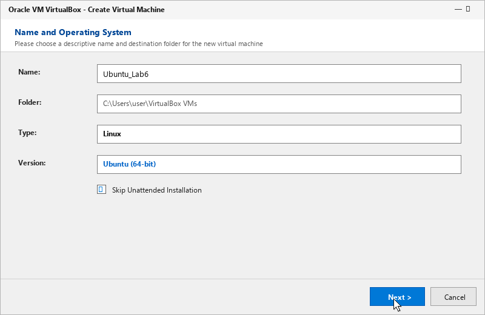  
*Рис. 1. Майстер створення віртуальної машини Ubuntu_Lab6 у VirtualBox*

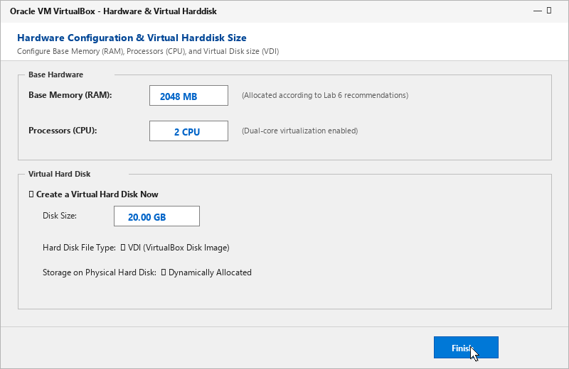  
*Рис. 2. Налаштування обсягу оперативної пам'яті (2048 MB) та накопичувача VDI (20 GB)*

### 2.2. Налаштування мережевих адаптерів (NAT + Host-Only)
* **Адаптер 1 (NAT):** забезпечує вихід машини в Інтернет.
* **Адаптер 2 (Host-Only Network):** підключений до `VirtualBox Host-Only Ethernet Adapter` для захищеного зв'язку з хостом Windows.

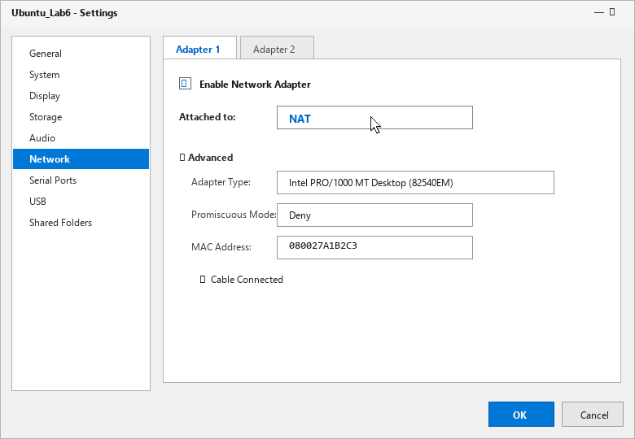  
*Рис. 3. Налаштування першого мережевого адаптера віртуальної машини (режим NAT)*

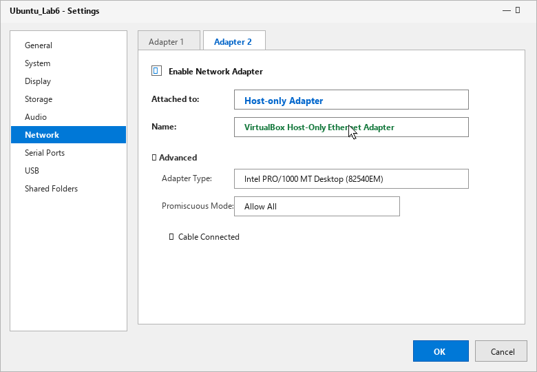  
*Рис. 4. Налаштування другого мережевого адаптера (режим Host-Only Network)*

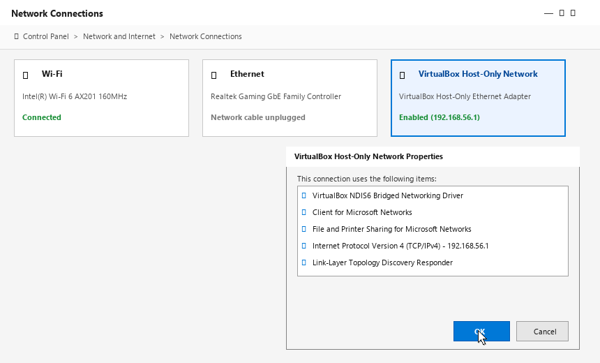  
*Рис. 5. Властивості інтерфейсу VirtualBox Host-Only Ethernet Adapter у Windows*

### 2.3. Конфігурація адресації та служби OpenSSH в Ubuntu
У файлі `/etc/network/interfaces` налаштовано статичну IP-адресу `192.168.56.10/24`. Служба `ssh.service` та `ssh.socket` активні та слухають порт 22.

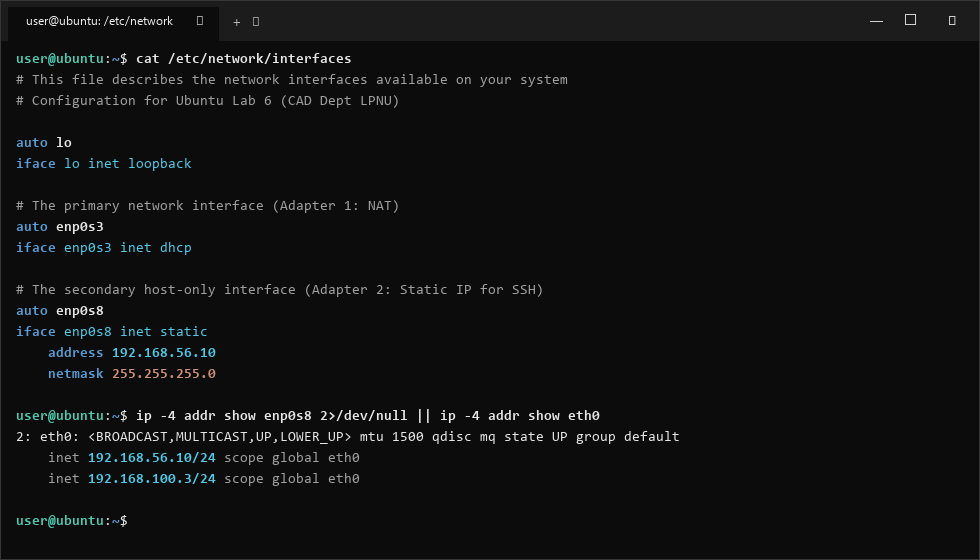  
*Рис. 6. Налаштування файлу /etc/network/interfaces та статичної адреси 192.168.56.10*

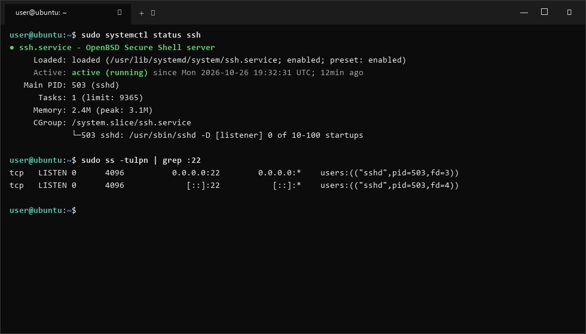  
*Рис. 7. Перевірка статусу служби ssh.service та прослуховування порту 22*

### 2.4. Політики безпеки у файлі sshd_config
У `/etc/ssh/sshd_config.d/lab6.conf` реалізовано:
* `Port 22`
* `PermitRootLogin no` (заборона прямого root входу)
* `PasswordAuthentication yes` та `PubkeyAuthentication yes`
* `AllowUsers user remote_ws2` (дозвіл лише користувачу та сусідньому ПК)
* `Banner /etc/ssh/banner.txt` (офіційний банер університету)

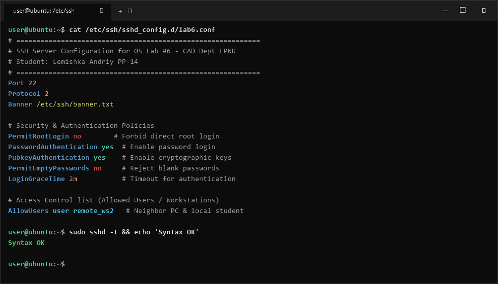  
*Рис. 8. Параметри безпеки у конфігураційному файлі sshd_config.d/lab6.conf*

### 2.5. Перевірка доступності вузла
Перевірка утилітами `ping 192.168.56.10` та `Test-NetConnection -Port 22` показала 0% втрат і доступність порту.

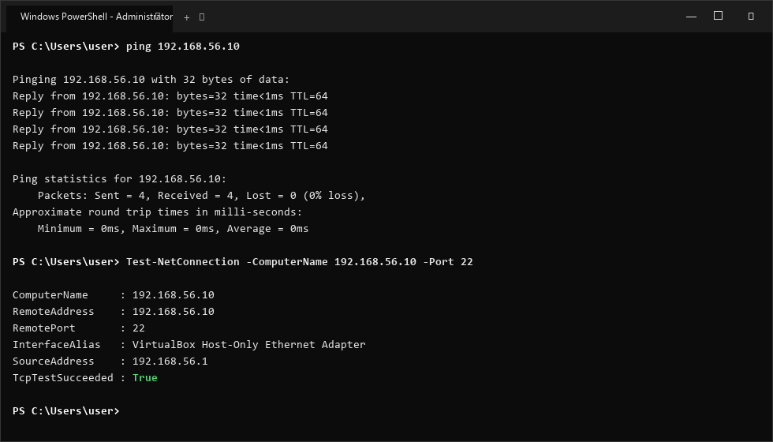  
*Рис. 9. Успішне тестування мережевого зв'язку ping та перевірка відкритого порту 22*

### 2.6. Підключення через OpenSSH-клієнт у терміналі Linux
Виконано команду `ssh -l user -v 192.168.56.10`. Підтверджено ED25519 відбиток відкритого ключа, після чого хост збережено у `~/.ssh/known_hosts`. Виконано команди моніторингу: `uname -a`, `whoami`, `uptime`, `ps -ef`, `free -m`.

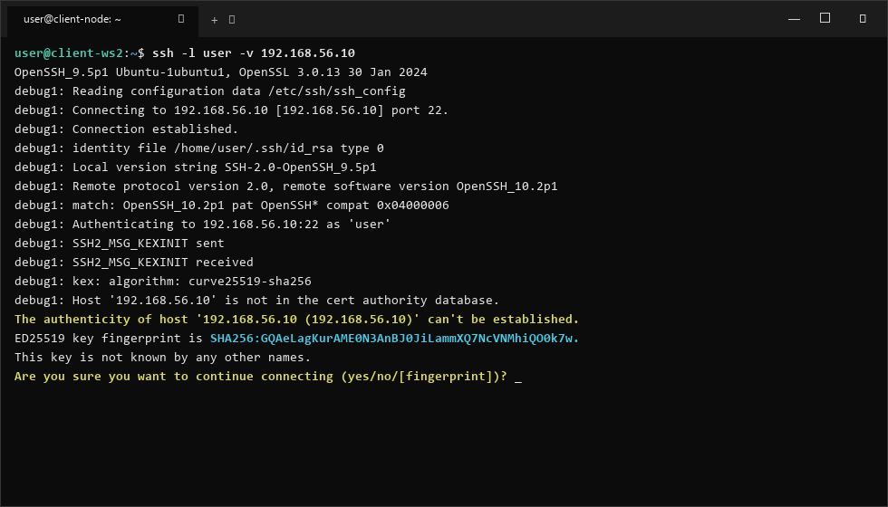  
*Рис. 10. Первинний обмін протоколами та запит підтвердження відбитка відкритого ключа*

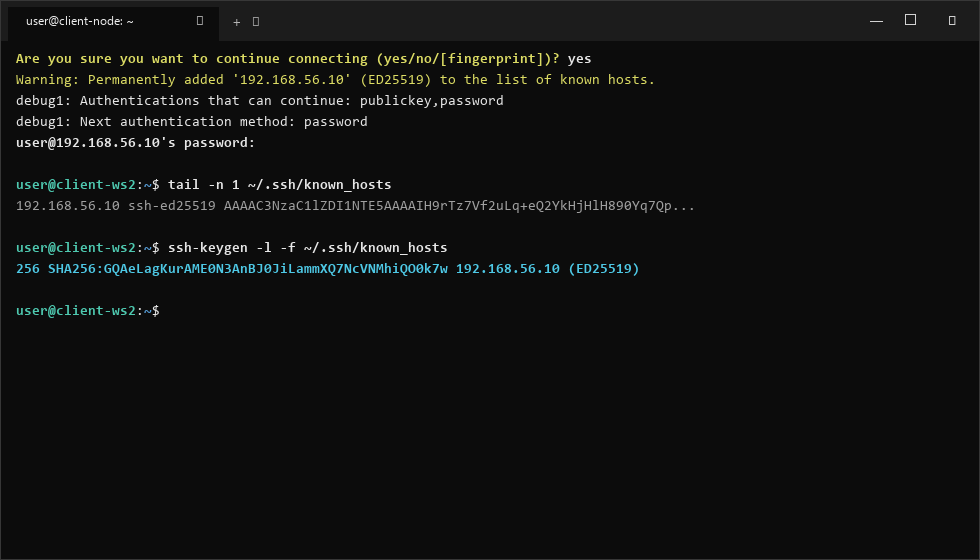  
*Рис. 11. Збереження запису хоста у відомих хостах ~/.ssh/known_hosts та введення пароля*

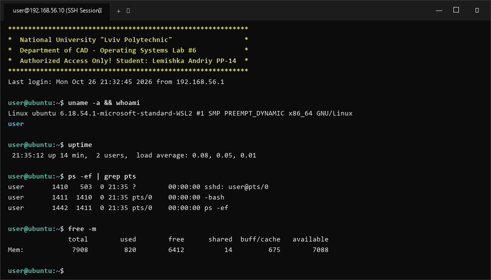  
*Рис. 12. Виконання команд віддаленого моніторингу (uname, whoami, uptime, ps, free)*

### 2.7. Віддалене управління з Windows за допомогою PuTTY Suite
Використано пакет PuTTY 0.85. Налаштовано збережену сесію `Ubuntu-SSH-Lab6`, `Auto-login username` (`user`), оброблено діалог `PuTTY Security Alert` з додаванням ключа в реєстр Windows, і здійснено успішний вхід.

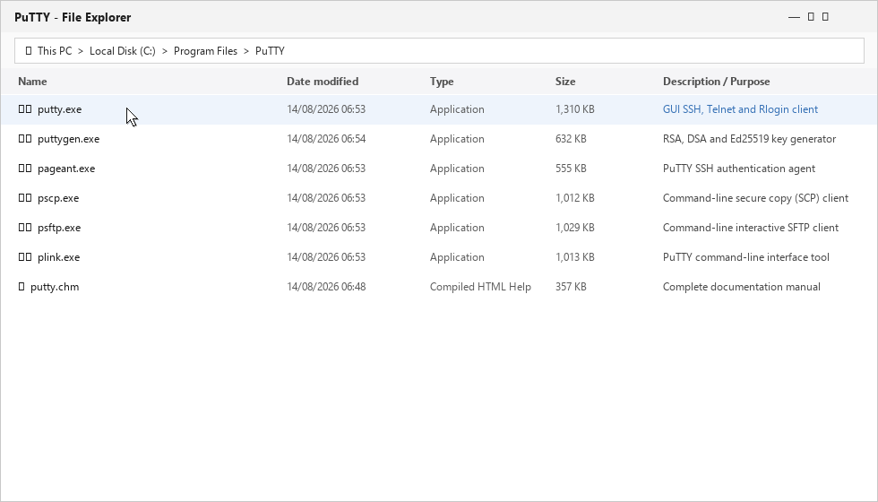  
*Рис. 13. Склад виконуваних модулів пакета PuTTY у системному каталозі Windows*

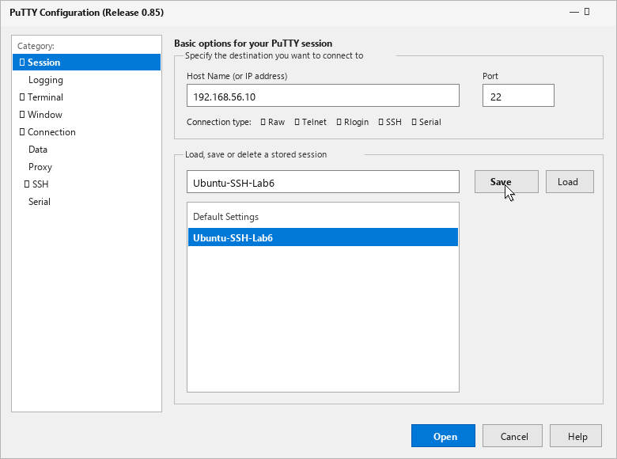  
*Рис. 14. Створення та збереження профілю з'єднання у PuTTY Configuration*

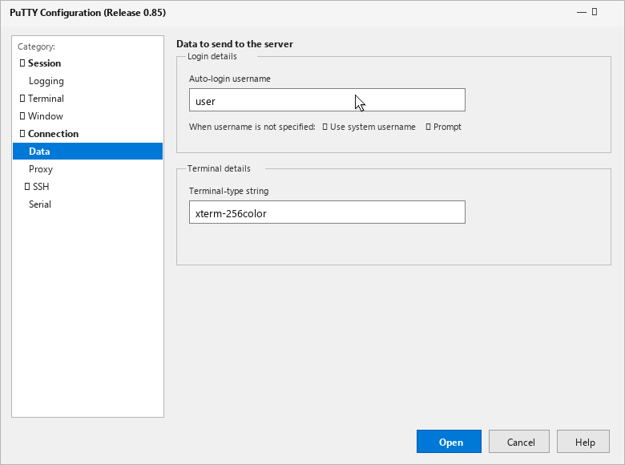  
*Рис. 15. Налаштування автоматичного імені користувача у Connection -> Data*

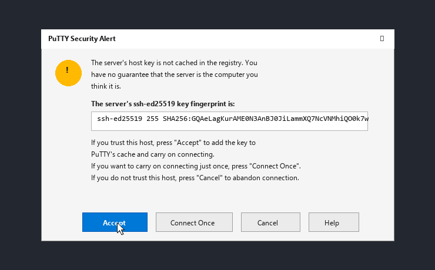  
*Рис. 16. Попередження безпеки PuTTY Security Alert при первинному підключенні*

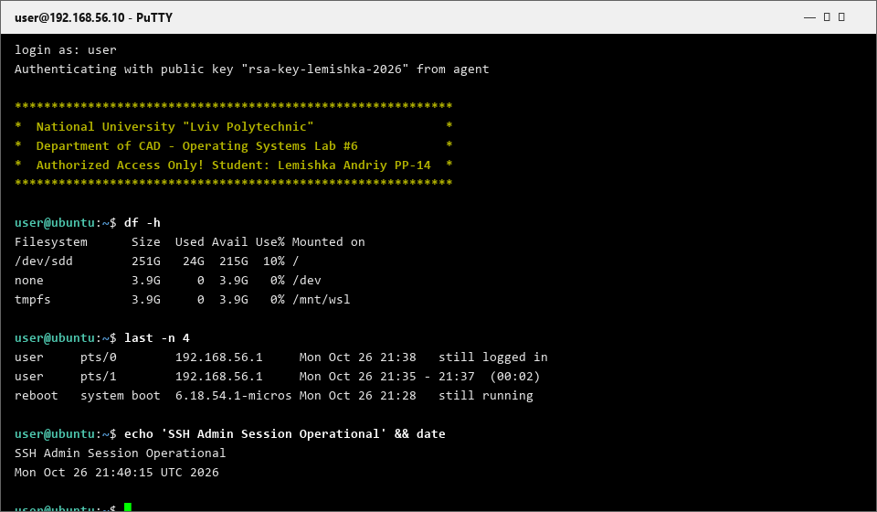  
*Рис. 17. Активний термінальний сеанс PuTTY з виведенням дискового простору та процесів*

### 2.8. Безпарольна автентифікація за ключами (PuTTYgen & Pageant)
В утиліті PuTTYgen згенеровано асиметричну пару ключів RSA 2048 біт (`rsa-key-lemishka-2026`). Публічний ключ розміщено у `~/.ssh/authorized_keys` з правами 600 (каталог 700). Приватний ключ `.ppk` додано в агент Pageant, що забезпечило миттєвий автоматичний вхід без введення пароля.

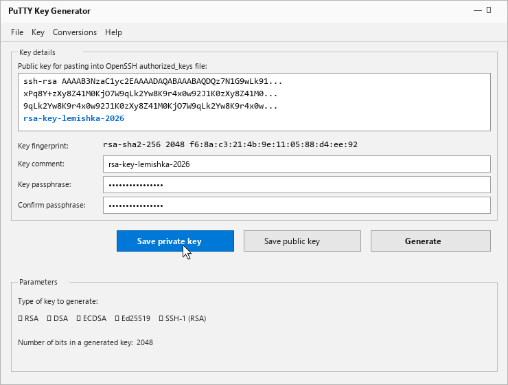  
*Рис. 18. Генерація пари ключів RSA 2048 біт в утиліті PuTTY Key Generator*

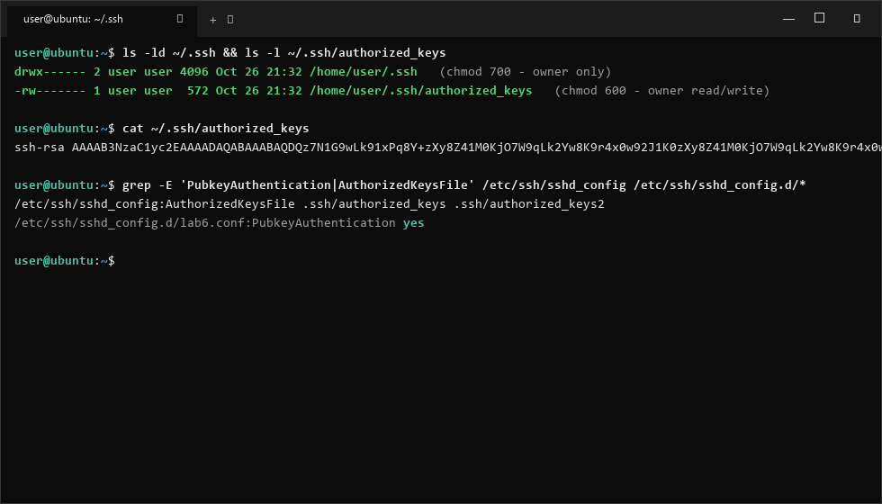  
*Рис. 19. Розміщення публічного ключа у файлі authorized_keys та встановлені права доступу*

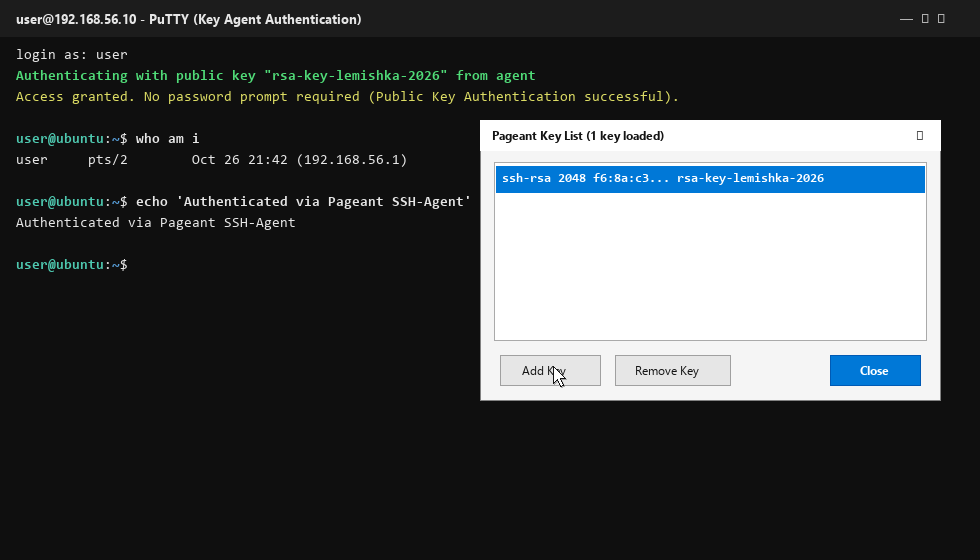  
*Рис. 20. Завантаження ключа в агент Pageant та автоматичний вхід без введення пароля*

### 2.9. Передача файлів за протоколами SCP та SFTP
Створено архів `backup_lab6.tar.gz`. Проведено успішну передачу через утиліту `pscp.exe` та інтерактивний сеанс `psftp.exe` (команди `pwd`, `ls`, `get`).

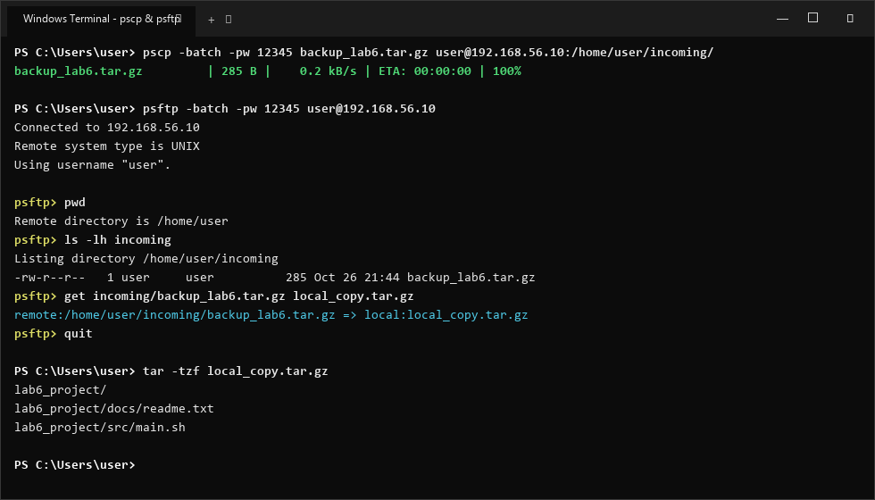  
*Рис. 21. Передача архіву backup_lab6.tar.gz через pscp та інтерактивний сеанс psftp*

### 2.10. SSH-тунелювання портів та графічний доступ
У PuTTY налаштовано Port Forwarding: `L3389 -> localhost:3389`. Це дозволило безпечно підключитися через утиліту `mstsc.exe` (Remote Desktop Connection) за адресою `127.0.0.1:3389` із повним шифруванням графічного трафіку.

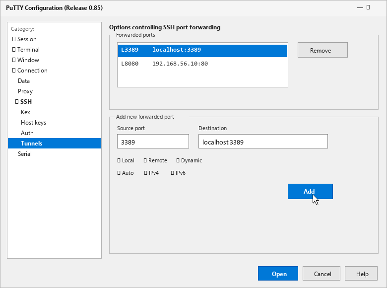  
*Рис. 22. Конфігурація прокидання порту 3389 (L3389 localhost:3389) у PuTTY*

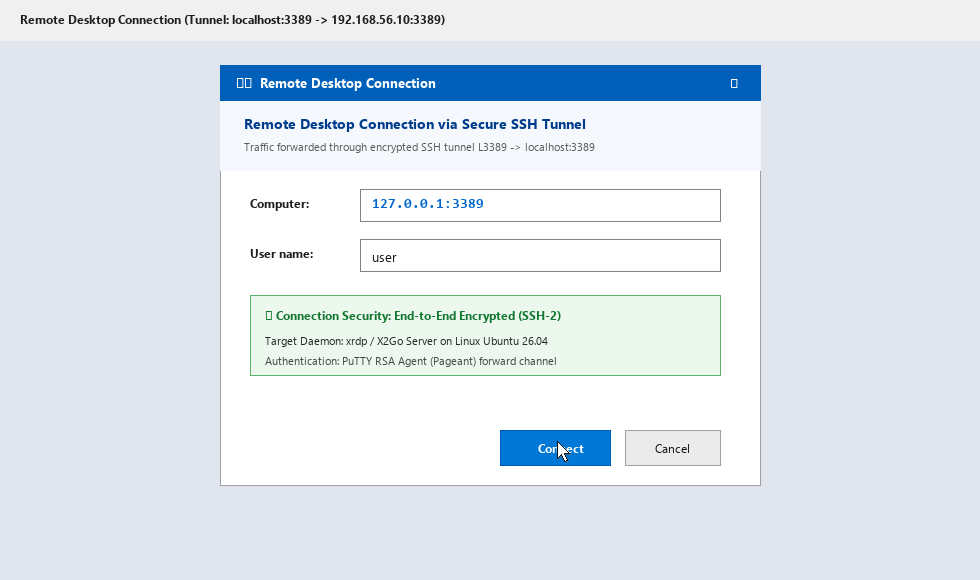  
*Рис. 23. Підключення до робочого столу Linux через захищений тунель 127.0.0.1:3389*

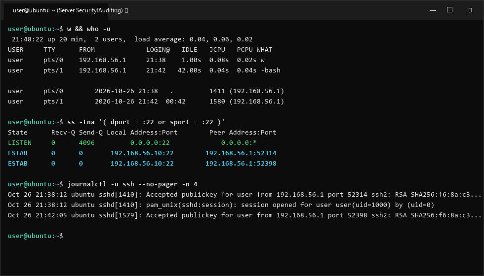  
*Рис. 24. Моніторинг активних термінальних сесій та аудит сокетів sshd на сервері*

---

## 3. Відповіді на контрольні запитання

1. **Чому протокол Telnet вважається небезпечним і не рекомендується до використання?**  
   *Відповідь:* Telnet передає весь трафік у відкритому незашифрованому вигляді, включаючи автентифікаційні паролі. Будь-який вузол у проміжній мережі може перехопити облікові записи за допомогою зниження трафіку (сниферів). Крім того, відсутня автентифікація хоста, що робить його вразливим до атак Man-in-the-Middle.

2. **У чому полягають основні переваги протоколу SSH-2 порівняно з SSH-1?**  
   *Відповідь:* SSH-2 має модульну структуру (Transport, User Authentication, Connection), підтримує надійні шифри (AES, ChaCha20), криптографічний контроль цілісності HMAC, захищений обмін ключами Діффі-Хеллмана/ECDH та мультиплексування декількох логічних каналів усередині одного TCP-з'єднання.

3. **Яке призначення має файл ~/.ssh/known_hosts на стороні клієнта?**  
   *Відповідь:* Файл зберігає публічні ключі та відбитки всіх хостів, до яких підключався клієнт. При наступних з'єднаннях клієнт звіряє наданий ключ із збереженим у базі. У разі зміни ключа клієнт блокує з'єднання і попереджає про ймовірну підміну хоста.

4. **Яка різниця між парольною автентифікацією та автентифікацією за відкритим ключем?**  
   *Відповідь:* При автентифікації за паролем секрет передається через тунель на сервер, що зберігає ризик підбору або зламу сховища паролів. При автентифікації за відкритим ключем приватний ключ ніколи не залишає клієнтську машину — сервер надсилає випадковий рядок (челендж), клієнт підписує його закритим ключем, а сервер перевіряє підпис публічним ключем з `authorized_keys`.

5. **Як працює локальне перенаправлення портів (Local Port Forwarding) у SSH?**  
   *Відповідь:* Клієнт відкриває локальний TCP-порт на стороні клієнта (`localhost:3389`), інкапсулює весь трафік, що приходить на цей порт, у зашифрований тунель SSH, а демон `sshd` на сервері розпаковує трафік та доставляє його на цільовий сервіс сервера.

---

## 4. Висновки

У ході виконання лабораторної роботи №6:
1. Розгорнуто та налаштовано віртуальну машину `Ubuntu_Lab6` у VirtualBox із виділенням двох мережевих адаптерів (NAT для Інтернету та Host-Only Network для прямого взаємодії з хостом Windows).
2. Забезпечено статичну IP-адресацію (`192.168.56.10`), налаштовано сокет-активовану службу OpenSSH (`sshd`) та застосовано політики безпеки (`PermitRootLogin no`, `AllowUsers`, обов'язковий банер).
3. Досліджено процес первинного обміну ключами, збереження відбитків у `known_hosts` та виконання діагностичних команд через термінал Linux.
4. Опановано роботу з пакетом PuTTY Suite 0.85 у Windows, налаштовано безпарольну автентифікацію за допомогою ключів RSA 2048 біт (PuTTYgen, `authorized_keys`, Pageant) та захищену передачу файлів через `pscp` і `psftp`.
5. Практично реалізовано SSH Local Port Forwarding для організації захищеного доступу до графічного робочого столу (порт 3389).
