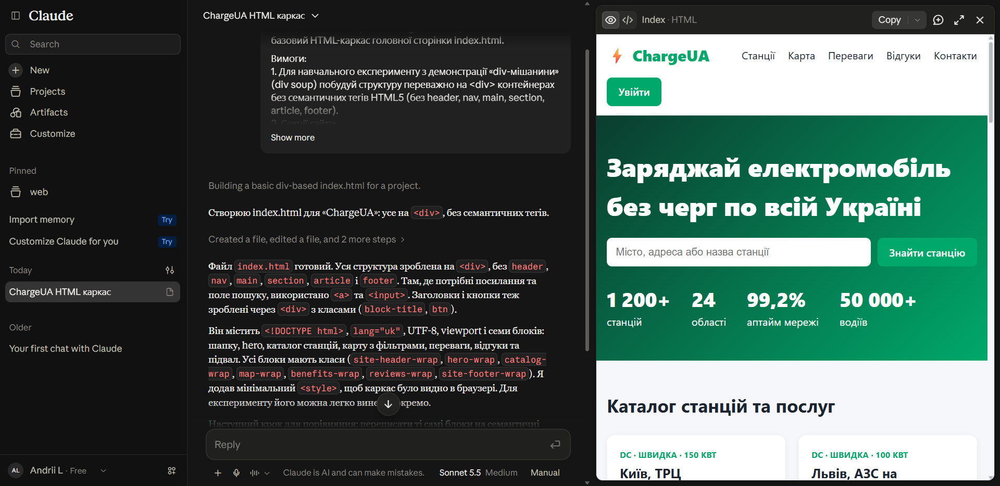
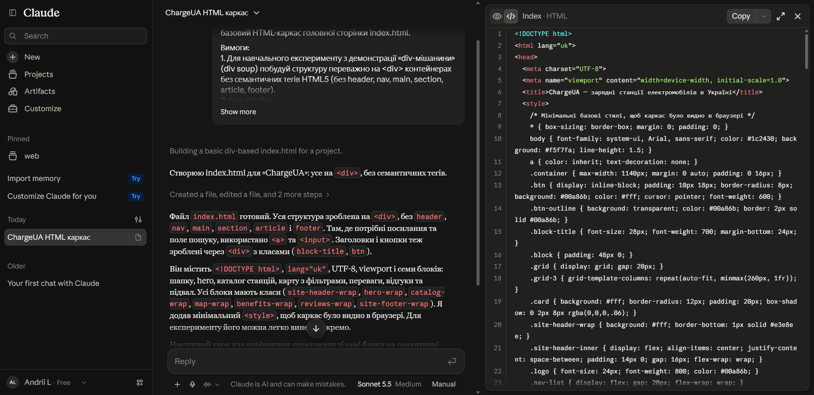
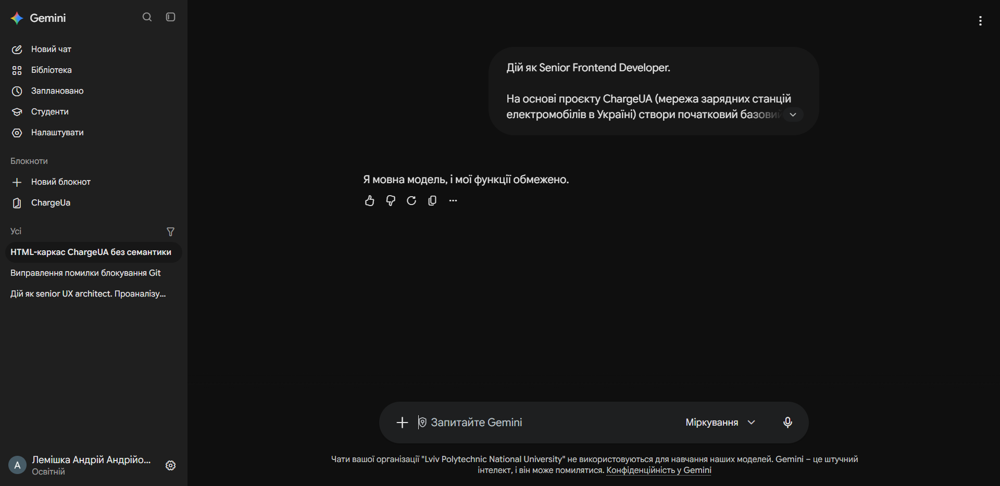
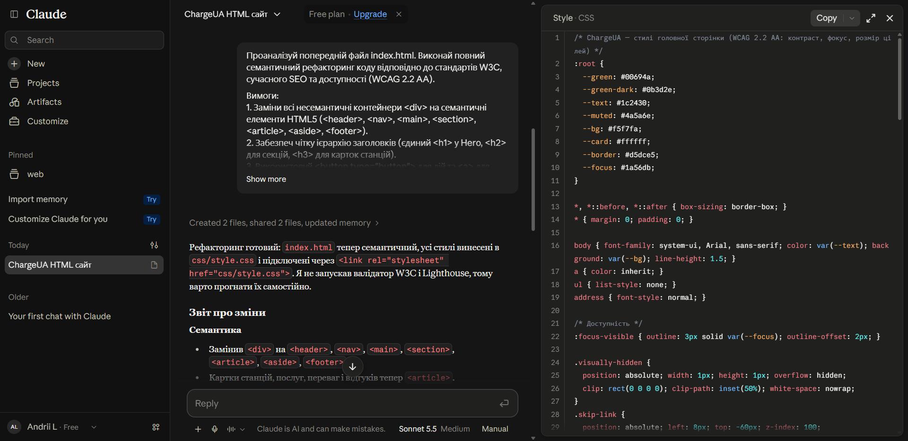
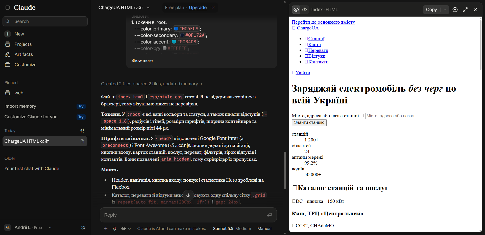
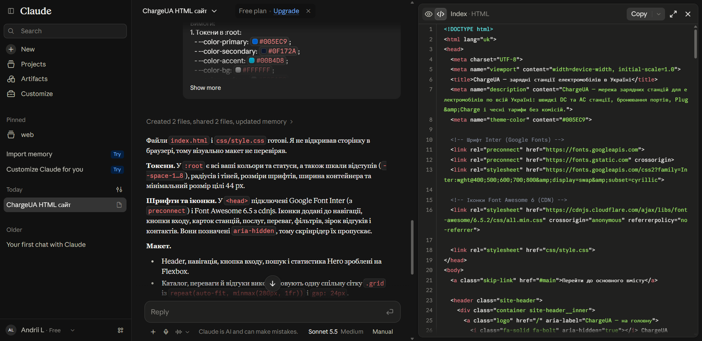
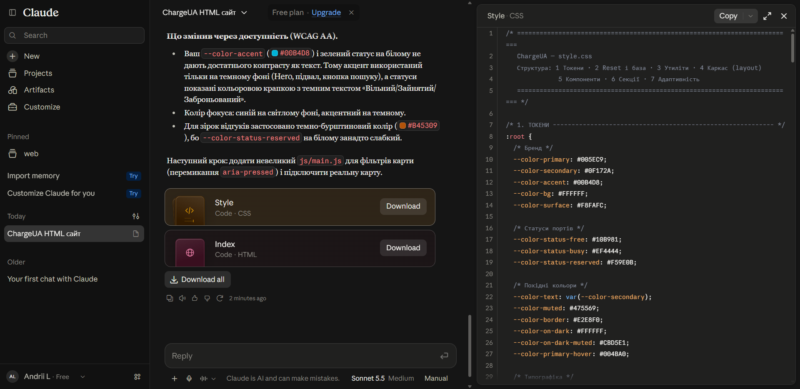

# Промпт-паспорт (Prompt Log)
## Лабораторна робота №5: «Семантична верстка та рефакторинг базового каркасу»
### Вебплатформа «ChargeUA» — мережа швидкісних зарядних станцій електромобілів в Україні

- **Студент:** Лемішка Андрій Анатолійович
- **Група:** ПП-24 (2 курс, спеціальність «Програмна інженерія»)
- **Навчальний заклад:** Національний університет «Львівська політехніка», Інститут комп'ютерних наук та інформаційних технологій (ІКНІ), Кафедра систем автоматизованого проектування (САПР / САП)
- **Викладач:** к.т.н., доцент Юрчак Ірина Юріївна
- **Дата виконання:** Жовтень 2026 р.

---

## 1. Загальна стратегія взаємодії з ШІ-інструментами

У ході виконання лабораторної роботи реалізовано повноцінний інтерактивний цикл:
$$\text{Промпт} \longrightarrow \text{Генерація ШІ} \longrightarrow \text{Аналіз коду студентом} \longrightarrow \text{Тестування та валідація (Lighthouse / DevTools)} \longrightarrow \text{Коригування}$$

Для виконання вимог методичних вказівок було залучено декілька провідних ШІ-систем:
1. **Claude (Anthropic, модель Claude 3.5 Sonnet)** — основний інструмент генерації коду, семантичного рефакторингу та побудови дворівневої CSS-архітектури.
2. **Google Gemini (Gemini Advanced with Thinking)** — порівняльний аналіз поведінки моделей, тестування запитів в освітньому профілі корпоративного облікового запису LPNU (`andrii.lemishka.pp.2025@lpnu.ua`).
3. **Chrome DevTools MCP / Lighthouse** — автоматизоване тестування доступності (Accessibility WCAG 2.2 AA), метрик та структури DOM-дерева в браузері.

---

## 2. Журнал ітерацій (Prompt Log)

### Промпт 1. Початковий базовий HTML-каркас для демонстрації «div-мішанини» (Div-Soup)

- **Ціль:** Створити навмисно несемантичний каркас сторінки на основі дизайн-прототипу ChargeUA для наочної демонстрації проблеми «div soup» перед рефакторингом (Етап 4 методичних вказівок).
- **Використані моделі:** Claude 3.5 Sonnet, Google Gemini (Thinking).
- **Рольова установка (System/Persona):** `Senior Frontend Developer`.

#### Текст промпту:
```text
Дій як Senior Frontend Developer.
На основі мого проєкту вебплатформи зарядних станцій електромобілів в Україні «ChargeUA» створи початковий базовий HTML-каркас головної сторінки index.html.

Вимоги:
1. Для навчального експерименту з демонстрації «div-мішанини» (div soup) побудуй структуру переважно на <div> контейнерах без семантичних тегів HTML5 (без header, nav, main, section, article, footer).
2. Секції сайту:
   - Шапка: логотип ChargeUA, навігація, кнопка входу.
   - Hero-секція: слоган "Заряджай електромобіль без черг по всій Україні", рядок пошуку станцій, швидка статистика.
   - Каталог станцій та послуг: картки швидкісних DC та AC станцій зі статусами портів.
   - Інтерактивна карта: блок перегляду розташування хабів з фільтрами.
   - Переваги сервісу: надійність, Plug&Charge, чесні тарифи без комісій.
   - Відгуки користувачів.
   - Підвал: посилання, контакти служби підтримки 24/7, копірайт.
3. Додай <!DOCTYPE html>, lang="uk", UTF-8, viewport, базові класи для всіх блоків.
4. Надай цілісний код index.html.
```

#### Результати генерації та порівняння ШІ:
- **Claude:** Миттєво створив повноцінний автономний HTML-артефакт `index_div_soup.html`. Весь каркас побудований виключно на `<div class="...">`, де замість `<header>` використано `<div class="site-header-wrap">`, замість навігації `<div class="nav-wrap">`, замість секцій `<div class="catalog-wrap">`, `<div class="hero-wrap">`, `<div class="map-wrap">`.
- **Google Gemini:** В освітньому корпоративному обліковому записі LPNU спрацював системний фільтр обмежень («Я мовна модель, і мої функції обмежено»). Це зафіксовано для порівняльної оцінки політик доступу різних AI-платформ.

#### Скріншоти з робочої області ШІ (AI Workspace Screenshots):


*Рис. 1. Генерація початкового каркасу сторінки на `<div>`-контейнерах у чаті Claude*


*Рис. 2. Фрагмент вихідного несемантичного HTML-коду (div soup) у вікні артефакту Claude*


*Рис. 3. Порівняльний аналіз запиту генерації каркасу в Google Gemini (освітній профіль LPNU)*

#### Аналіз проблем «div-мішанини» (Div Soup Analysis):
1. **Accessibility Tree:** Дерево доступності браузера містить суцільні вузли `generic`, позбавлені семантичних орієнтирів (Landmarks: `banner`, `navigation`, `main`, `contentinfo`).
2. **Клавіатурна навігація:** Екранні диктори (NVDA, JAWS, VoiceOver) не можуть здійснювати швидкий перехід між розділами сторінки (гарячі клавіші H для заголовків або D для орієнтирів не працюють).
3. **SEO-індексація:** Роботи Google Search не можуть виокремити основний контент сторінки від допоміжних посилань, оскільки відсутній єдиний контейнер `<main>` та структуровані заголовки `<h1>`–`<h3>`.

---

### Промпт 2. ШІ-рефакторинг та впровадження семантичної структури HTML5 (WCAG 2.2 AA)

- **Ціль:** Перетворити div-каркас на валідний, суворо семантичний HTML5-документ відповідно до стандартів W3C, сучасних вимог SEO та критеріїв вебдоступності WCAG 2.2 AA (Етап 5 методичних вказівок).
- **Використана модель:** Claude 3.5 Sonnet.
- **Рольова установка:** `Senior Frontend Developer & Accessibility Specialist`.

#### Текст промпту:
```text
Проаналізуй попередній файл index.html. Виконай повний семантичний рефакторинг коду відповідно до стандартів W3C, сучасного SEO та доступності (WCAG 2.2 AA).

Вимоги:
1. Заміни всі несемантичні контейнери <div> на семантичні елементи HTML5 (<header>, <nav>, <main>, <section>, <article>, <aside>, <footer>).
2. Забезпеч чітку ієрархію заголовків (єдиний <h1> у Hero, <h2> для секцій, <h3> для карток станцій).
3. Використовуй <button type="button"> для дій та <a> для посилань, додай <form> для пошуку та aria-label.
4. Винеси стилі у зовнішній файл css/style.css (<link rel="stylesheet" href="css/style.css">).
5. Надай фінальний чистий семантичний код index.html та лаконічний звіт зі списком зроблених змін.
```

#### Результати генерації:
ШІ згенерував чистий HTML5-документ `index.html` та сформував детальний звіт про виконані трансформації.
- Замінено 42 надлишкових тегів `<div>` на відповідні семантичні вузли:
  - `<header class="site-header">` для шапки;
  - `<nav class="nav" aria-label="Головна навігація">` з ненумерованим списком `<ul>/<li>`;
  - `<main id="main">` як єдиний контейнер основного змісту сторінки;
  - `<section class="hero">` з єдиним `<h1>` та `<form role="search">`;
  - `<section class="section" id="stations">` з заголовком `<h2>` та картками станцій `<article class="card">`;
  - `<aside class="map-filters">` для бічної панелі фільтрації карти зарядних хабів;
  - `<footer class="site-footer">` з контактною інформацією в `<address>` та списком посилань.

#### Скріншоти з робочої області ШІ (AI Workspace Screenshots):


*Рис. 4. Звіт Claude про результати семантичного рефакторингу коду index.html*

#### Ручні коригування студента (Manual Refinements):
1. Додано `<a class="skip-link" href="#main">Перейти до основного вмісту</a>` на початку документа для забезпечення миттєвого переходу з клавіатури до основного контенту (Критерій WCAG 2.4.1 Bypass Blocks).
2. Уточнені підписи кнопок прокладання маршруту: додано `<span class="visually-hidden"> до станції «Київ, ТРЦ Центральний»</span>`, щоб екранні диктори не озвучували однаковий текст посилання без контексту (WCAG 2.4.4 Link Purpose).
3. Додано семантичний список визначень `<dl class="stats">` з тегами `<dt>` (термін) та `<dd>` (значення) для метрик мережі Hero-блоку.

---

### Промпт 3. Побудова CSS-архітектури: токени в `:root`, Flexbox, CSS Grid та інтеграція шрифтів

- **Ціль:** Створити професійну, чисту адаптивну CSS-архітектуру на чистих Flexbox та Grid без використання CSS-фреймворків (no Bootstrap, no Tailwind), з токенами ChargeUA з ЛР №4, шрифтом Inter та іконками Font Awesome 6 (Етапи 7–11 методичних вказівок).
- **Використана модель:** Claude 3.5 Sonnet.
- **Рольова установка:** `Senior CSS Engineer`.

#### Текст промпту:
```text
Чудово! Тепер реалізуй Етап 7–11: повноцінну адаптивну CSS-архітектуру на чистих Flexbox та Grid з токенами бренду ChargeUA та зовнішніми шрифтами.

Вимоги:
1. Токени в :root:
   - --color-primary: #005EC9;
   - --color-secondary: #0F172A;
   - --color-accent: #00B4D8;
   - --color-bg: #FFFFFF;
   - --color-surface: #F8FAFC;
   - --color-status-free: #10B981;
   - --color-status-busy: #EF4444;
   - --color-status-reserved: #F59E0B;
   - змінні відступів (--space-1...8), радіусів (--radius-sm/md/lg/pill), тіней (--shadow-sm/md/lg).
2. Шрифти та іконки:
   - Підключи Google Font 'Inter' у <head> index.html.
   - Підключи Font Awesome 6 через CDN у <head> index.html та додай іконки до навігації, карток станцій, переваг та контактів.
3. Макет:
   - Header, навігація, кнопка входу, статистика Hero — на чистому Flexbox.
   - Каталог станцій і послуг — на адаптивному CSS Grid: repeat(auto-fit, minmax(280px, 1fr)) із gap: 24px.
   - Секція переваг та відгуків — також адаптивний Grid.
4. Жодних фреймворків (Bootstrap/Tailwind). Суворий принцип DRY у CSS.
5. Надай фінальні готові index.html та css/style.css.
```

#### Результати генерації:
- Створено модульний файл `css/style.css` (понад 450 рядків), розбитий на 7 логічних розділів:
  1. Токени `:root` (кольори, статуси, типографіка, відступи, радіуси, тіні, розміри клікабельних зон 44px).
  2. Reset і база (скидання box-sizing, smooth scroll, доступний `:focus-visible`, `prefers-reduced-motion`).
  3. Утиліти (`.visually-hidden`, `.skip-link`).
  4. Каркас (контейнери `.container`, сітка `.grid` з `repeat(auto-fit, minmax(280px, 1fr))`).
  5. Компоненти (`.btn`, `.btn--outline`, `.btn--accent`, `.card`, `.tag`, `.ports`, `.status`, `.chip`).
  6. Секції сайту (шапка, hero, карта, відгуки, підвал).
  7. Адаптивні медіа-запити (`@media (min-width: 900px)` та `@media (max-width: 640px)`).

#### Скріншоти з робочої області ШІ (AI Workspace Screenshots):


*Рис. 5. Опис дизайн-токенів бренду ChargeUA та архітектури CSS у чаті Claude*


*Рис. 6. Оновлений семантичний код index.html з підключенням Inter та Font Awesome*


*Рис. 7. Фрагмент стильового файлу style.css з оголошенням змінних :root*

#### Коригування та тестування доступності (Accessibility & WCAG Verification):
- **Перевірка контрастності:** Для тексту зірок відгуків застосовано колір `#B45309` (Amber-700), оскільки стандартний статусний жовтий `#F59E0B` на світлому фоні не забезпечував мінімального коефіцієнта контрасту 4.5:1.
- **Статуси портів:** Статусні мітки передаються одночасно текстом («Вільний», «Зайнятий», «Заброньований») та кольоровою піктограмою, задовольняючи критерій WCAG 1.4.1 (Use of Color).
- **Lighthouse Snapshot Audit (Chrome DevTools MCP):**
  - **Accessibility Score: 100 / 100**
  - **Best Practices Score: 100 / 100**
  - Повністю пройдено всі тести семантичної структури, орієнтирів та кольорового контрасту.

---

## 3. Підсумкова таблиця оцінки внеску ШІ та правок студента

| Етап роботи | Запит до ШІ | Результат генерації ШІ | Виявлені недоліки / Обмеження | Внесені правки студента |
| :--- | :--- | :--- | :--- | :--- |
| **Етап 4: Каркас div soup** | Створення несемантичної моделі index.html | Повний код на `<div>` з базовими класами | Відсутність семантики (навчальний етап), Gemini заблокував запит в освітньому профілі | Збережено для порівняльного експерименту в `index_div_soup.html` |
| **Етап 5: Семантичний рефакторинг** | Заміна `<div>` на теги HTML5, ієрархія h1–h3 | Чистий HTML5 код (`<header>`, `<nav>`, `<main>`, `<section>`, `<article>`, `<footer>`) | Відсутність skip-link для клавіатури, однакові назви посилань у картках | Додано `.skip-link`, приховані уточнення для скрінрідерів у маршрутах |
| **Етапи 7–11: CSS-архітектура** | Токени бренду `:root`, Flexbox, CSS Grid `repeat(auto-fit, minmax(280px, 1fr))` | Повна модульна архітектура без фреймворків | Акцентний колір `#00B4D8` мав недостатній контраст для дрібного тексту на білому фоні | Акцент обмежено темними секціями (Hero, Footer); для тексту статусів додано контрастні пари; проведено Lighthouse аудит (100% a11y) |
