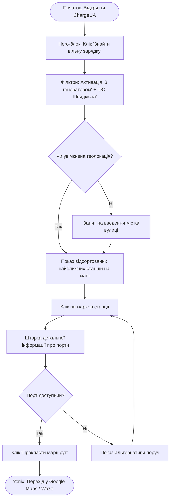
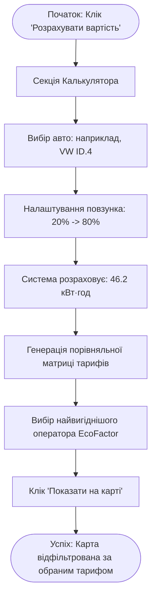
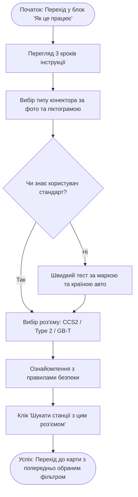

# Етап 2. Проєктування Шляху Користувача (User Flows)
**Проєкт**: Вебплатформа «ChargeUA»  
**Роль**: Senior UX Designer  
**Студент**: Лемішка Андрій Анатолійович (група ПП-24)  

---

## 1. Сценарій 1: Екстрений пошук працюючої станції під час блекауту
*Цільовий сегмент: Комерційні водії (таксі, кур'єри) або водії з критичним рівнем заряду (< 15%).*

1. **Мета користувача**: За 1-2 кліки знайти найближчу вільну швидкісну DC-станцію, що працює від генератора, та запустити маршрут у навігаторі.
2. **Початкова точка**: Головна сторінка сервісу (Hero Section на смартфоні).
3. **Послідовність екранів/блоків**:
   `Головний екран (Hero)` → `Швидкі фільтри` → `Секція карти (або /map)` → `Модальне вікно / Шторка станції` → `Зовнішній навігатор (Google Maps / Waze)`.
4. **Дії користувача**:
   - Натискає кнопку експрес-фільтра **«🔋 З генератором»** та **«⚡ Швидкісні DC»**.
   - Обирає найближчий маркер на карті із зеленим статусом (вільний порт).
   - Перевіряє актуальність даних та натискає кнопку **«Прокласти маршрут»**.
5. **Реакції системи**:
   - Карта миттєво фільтрує маркери, залишаючи станції з бейджем «Автономне живлення».
   - Центрує карту за поточною геолокацією користувача.
   - Відкриває шторку картки станції із зазначенням: адреси, доступних портів (наприклад: *CCS2 120 кВт — Вільний*), тарифу та часу останнього оновлення.
6. **Стан успішного завершення (Success State)**:
   - Маршрут успішно передано до застосунку навігації; водій отримує чітку вказівку часу прибуття та підтвердження, що станція в мережі.
7. **Можливий стан помилки та обробка (Fail State & Recovery)**:
   - *Помилка*: Порт станції зайняли кілька секунд тому (статус змінився на «Зайнято»).
   - *Реакція*: Система показує попередження жовтого кольору `⚠️ Порт щойно зайнято` і автоматично пропонує альтернативу: `Найближча альтернативна станція: 850 м (вільно 2 порти CCS2)`.

---

## 2. Сценарій 2: Розрахунок вартості та порівняння тарифів операторів
*Цільовий сегмент: Щоденні міські водії, раціональні власники електромобілів.*

1. **Мета користувача**: З'ясувати точну вартість поповнення заряду від 20% до 80% для свого автомобіля та вибрати оператора з найнижчим тарифом.
2. **Початкова точка**: Головна сторінка → Блок «Інтерактивний калькулятор».
3. **Послідовність екранів/блоків**:
   `Hero CTA 'Розрахувати вартість'` → `Калькулятор батареї` → `Таблиця / Картки порівняння тарифів` → `Закріплення вибору станції на мапі`.
4. **Дії користувача**:
   - Обирає марку та модель свого авто зі списку (або вводить ємність батареї вручну, наприклад: *Volkswagen ID.4, 77 кВт·год*).
   - Перетягує двоточковий повзунок: початковий заряд 20%, цільовий — 80%.
   - Переглядає обчислений обсяг енергії (46.2 кВт·год) та порівняльну таблицю мереж (Yasno, EcoFactor, TOKA).
   - Натискає «Показати станції оператора на карті».
5. **Реакції системи**:
   - Автоматично підставляє паспортну ємність акумулятора та рекомендований тип порту.
   - Миттєво перераховує вартість для кожної мережі з урахуванням діючих тарифів:
     * *EcoFactor: 14.50 грн/кВт·год → ~670 грн*
     * *Yasno E-mobility: 16.00 грн/кВт·год → ~739 грн*
   - Підсвічує найвигідніший варіант бейджем `🔥 Найкраща ціна`.
   - При виборі оператора фільтрує інтерактивну мапу, показуючи станції цієї мережі.
6. **Стан успішного завершення (Success State)**:
   - Водій знає точну суму витрат і бачить найближчу станцію з цим тарифом.
7. **Можливий стан помилки та обробка (Fail State & Recovery)**:
   - *Помилка*: Користувач намагається встановити цільовий рівень заряду нижчим за поточний (наприклад: з 80% до 20%).
   - *Реакція*: Система блокує перетин повзунків (min/max constraint) та виводить підказку: `Цільовий заряд повинен бути вищим за поточний`.

---

## 3. Сценарій 3: Перша підзарядка новачка (Онбординг та покроковий гайд)
*Цільовий сегмент: Нові власники електромобілів, які заряджаються на публічній станції вперше.*

1. **Мета користувача**: Зрозуміти, який тип роз'єму сумісний із його автомобілем, та покроково дізнатися, як безпечно розпочати процес зарядки.
2. **Початкова точка**: Головне меню або блок «Як це працює».
3. **Послідовність екранів/блоків**:
   `Головна сторінка` → `Секція 'Як це працює' / Гайд` → `Інтерактивний селектор конекторів` → `Перехід до карти сумісних станцій`.
4. **Дії користувача**:
   - Натискає пункт меню «Як це працює».
   - Ознайомлюється з 3 кроками підключення (1. Знайди → 2. Підключи → 3. Слідкуй).
   - Обирає візуальну піктограму свого роз'єму (наприклад: комбінований порт *CCS Combo 2*).
   - Натискає кнопку «Знайти станції з роз'ємом CCS2».
5. **Реакції системи**:
   - Розгортає чітку інструкцію з техніки безпеки (вставити конектор до клацання, запустити сесію через QR або додаток, перевірити світлодіодний індикатор).
   - Підсвічує сумісні моделі авто для обраного порту.
   - Застосовує фільтр портів на карті.
6. **Стан успішного завершення (Success State)**:
   - Користувач позбувся страху неправильного підключення та перейшов до карти перевірених станцій.
7. **Можливий стан помилки та обробка (Fail State & Recovery)**:
   - *Помилка*: Користувач не знає, який роз'єм у його авто (пригнане з Китаю або США).
   - *Реакція*: Система пропонує швидкий помічник: `Оберіть країну походження вашого авто (США — Type 1 / CCS1, Європа — Type 2 / CCS2, Китай — GB/T)` і автоматично підказує потрібний конектор.

---

## 4. Контрольний аналіз користувацьких шляхів (UX Check):
- **Чи немає зайвих кроків?** Ні, всі сценарії лінійні, містять не більше 3-4 взаємодій до цільового результату і не вимагають реєстрації чи заповнення довгих форм.
- **Чи зрозуміло, куди переходить користувач?** Так, усі кнопки дій (CTA) мають однозначний мікрокопірайтинг («Прокласти маршрут», «Показати на карті», «Знайти з роз'ємом CCS2»).
- **Чи є завершення сценарію?** Так, кожен сценарій має чітку точку тріумфу (Success State): перехід у навігатор, вибір дешевого тарифу або запуск безпечної сесії зарядки.
- **Чи передбачено помилки?** Так, для кожного сценарію закладено резервний шлях (Fallback) та захист від помилкових дій користувача.
